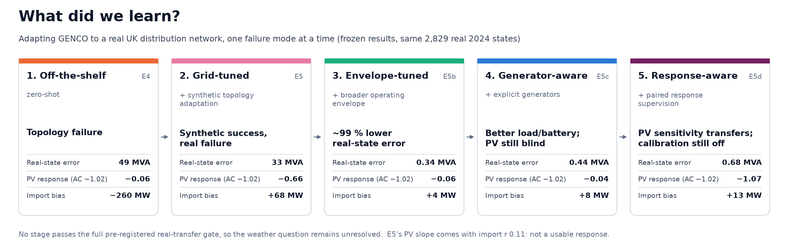

# ☁️⚡ Cloud2Grid

### Satellite-driven stress testing and interactive visualisation for GENCO

**Cloud2Grid** investigates whether GENCO remains reliable when power-grid operating states are driven by **real, spatially and temporally correlated satellite-observed weather**, rather than only by conventional synthetic perturbations.

The project combines:

- **GENCO / OpenGridFM**
- **EUMETSAT Meteosat imagery** for real cloud visualisation
- **EUMETSAT LSA SAF** satellite-derived surface solar radiation
- **UK Power Networks open data**
- **PV modelling**
- **classical AC power flow**
- a highly interactive **Streamlit event-replay application**

The central research question is:

> **Does GENCO generalise differently when renewable-generation perturbations have the real spatial and temporal structure produced by observed weather systems?**

The project has two equally important outputs:

1. **A rigorous controlled experiment** measuring GENCO's generalisation under satellite-driven grid states.
2. **A high-impact interactive visualisation** where users can watch a real cloud system move across the grid and immediately see its impact on solar generation, electrical flows, network stress and GENCO prediction error.

---

## Run the demo — Cloud2Grid Explorer

A Streamlit app that replays three frozen hero events: Meteosat imagery → satellite-derived PV
→ AC reference → GENCO zero-shot / E5 / E5b / E5c / E5d. It is CPU-only and reads precomputed bundles
in `data/demo/`. It runs no power flow, GENCO inference, download or training.

```bash
uv sync --group demo                                   # streamlit + plotly
uv run --group demo streamlit run demo/streamlit_app.py
```

Rebuilding the bundles needs the local research outputs (frozen predictions, satellite tables,
E-View frames) and runs offline in about a minute:

```bash
uv run python scripts/build_demo_events.py             # → data/demo/ (≈3 MB)
```

Pages: **Overview** (the question, the finding and one frozen moment of the 15 June story),
**Demo** (play the story or the event; switch AC / zero-shot / E5 / E5b / E5c / E5d),
**Scientific story**, **PV response** (the central finding: the PV blind spot and what closed it),
**Model evolution**, **Data & attribution**. Deployment: [`docs/DEMO.md`](docs/DEMO.md).



**Result in one line.** In our experiments, synthetic-to-real transfer needed not only topology
and operating-envelope coverage, but explicit learning of physically meaningful sensitivities.
- **What E5d achieved:** the response-aware model learns the PV sensitivity from paired synthetic AC
  states, and it transfers to real operation (PV slope −1.07 vs AC −1.02).
- **What still fails:** its import is ~13 MW too high, and the voltage and battery criteria fail
  (verdict E5D-D, partial).
- **Why the level is wrong:** a post-hoc diagnostic (E6, below) explains the import error.
- **The weather question remains unresolved,** because no model passes the full real-transfer gate.

**Licensing.** Cloud2Grid source code: Apache-2.0 ([`LICENSE`](LICENSE)). Released model weights (`cloud2grid-models-v1`): Apache-2.0 for Cloud2Grid's contribution, fine-tuned from the Apache-2.0 GENCO checkpoint. Synthetic verification dataset: CC BY 4.0. Third-party data, imagery and checkpoints keep their own licences and attribution requirements, and the demo bundles, reports and figures are not relicensed: see [`NOTICE`](NOTICE) and [`docs/DATA_LICENSES.md`](docs/DATA_LICENSES.md).

**Repository snapshot.** This repository is a single snapshot of the final project state; the development history is not included. Commit IDs cited in reports, registries and bundle metadata (pre-registration, freeze and build commits) refer to that development history.

## Frozen models and independent verification (`cloud2grid-models-v1`)

The frozen **E5c** and **E5d** checkpoints are published as GitHub Release assets, with a held-out synthetic verification set. One command re-runs both models and checks the main synthetic finding:

```bash
uv sync --extra genco                      # Linux x86-64
uv run python reproduce/verify_models.py   # CPU by default; --device gpu optional
```

**What is independently reproducible** (synthetic, held-out data, actual inference):
- E5c's PV blindness (import slope ratio 0.014);
- E5d's recovery of the PV, battery and load responses, including branch flows and voltages;
- both models' remaining ~14 MW absolute import error.

**What is not:**
- **The real 2024 results:** PV slopes AC −1.02 / E5c −0.04 / E5d −1.07, E5d's +13 MW offset, and the **E5D-D partial-transfer verdict**. They need real operating data that are not published.
- **Training.**

**Known limitations, stated in the model cards:**
- **E5c generator-encoding caveat:** see below.
- **E5d is partial:** the E5D-D verdict.
- **Scope:** single network, synthetic training, flagged selections.

**Numerical determinism.**
- **GPU inference is not bit-for-bit deterministic** (most likely the order of GPU scatter-add reductions; not isolated). In our CUDA 12.6 setup, identical GPU runs differed by up to ~0.2 MW in decoded import and branch flows, while Vm and Va agree to ~1e-5. CPU inference is deterministic.
- **Effect on the published values:** they come from one GPU run, so the verifier's tolerances are set from this measured noise ([`reproduce/README.md`](reproduce/README.md)).
- **Claim thresholds** are the pre-registered E5d gates.

**Licences.**
- **Weights and code:** Apache-2.0.
- **Verification data:** CC BY 4.0.
- **Third-party material keeps its own terms:** see [`NOTICE`](NOTICE).
- **Where the assets live:** in GitHub Releases, not in Git history.

## Why does GENCO get the response right but the import level wrong? (E6 diagnostic)

> **Diagnostic only.** Post-hoc and not pre-registered. Held-out synthetic data. No model was trained for this diagnostic. Nothing frozen changed. Full analysis: [`reports/e6_feasibility_diagnostic.md`](reports/e6_feasibility_diagnostic.md).

**Mechanism (an exact identity).**
- GENCO does not predict the grid import directly. GraphKit's decoder computes it from the predicted voltages, as the flow out of the slack bus.
- All other injections are known inputs. So the import error equals the sum of the signed active-power mismatches the predicted state leaves at the 36 other buses, plus a small loss difference.
- This holds within 0.06 MW in every state.

**Synthetic evidence** (frozen E5d, 2,804 held-out states; 500 held-out PV pairs):

| | Value |
|---|---|
| Import MAE / fit | 14.21 MW; predicted = 21.1 + 0.623 × AC (compressed toward the 58 MW training mean; exports detected 22 %) |
| Per-bus mismatch vs their sum | ~0.7 MW per bus, sign-coherent; Σ ≈ 14 MW in absolute value |
| PV pairs: absolute error / error of the change | 11.68 MW / 0.046 MW; paired-error correlation 0.999 |

**Limits of response supervision.**
- The level error is shared by both states of a pair, so it cancels in the change that the response loss supervises.
- The original loss does penalise per-bus residuals, but not explicitly their aggregate signed imbalance.
- The slack branches are near-ideal (30–39 MW per µrad), so the angle errors that set the import are invisible to the Va error term.
- Whether the objective or the architecture is ultimately responsible is untested.

**Analytic balance (not a model improvement).** Summing the known injections gives 0.58 MW import MAE; adding GENCO's own predicted losses gives 0.20 MW. Both bypass GENCO's import, and neither makes its voltage state more consistent.

**E5c encoding caveat.**
- **The issue:** our generator-aware encoding (E5c, inherited by E5d) attaches the Leighton Buzzard generators to PQ buses. GraphKit's internal physics decoder sets their `Pg` to zero, so the model's physics feedback and physics loss omit that known generation.
- **What still holds:** evaluation restores it, so the frozen metrics remain valid evaluations of the implemented models.
- **What is untested:** the effect of correcting it.
- **How to read E5c:** *our generator-aware adaptation remained largely insensitive to PV.* The independent effect of a correctly integrated generator representation remains untested.
- **How to read E5d:** response supervision made the difference within this implementation, against the λ = 0 control. That does not make it universally necessary.

**Lesson.** Accurate electrical states, accurate physical sensitivities and global physical conservation are distinct model properties. Good performance on one does not guarantee the others.

**Follow-up direction: conservation-supervised GENCO.**
- E5d's objective plus an explicit global signed power-balance term.
- The generator encoding corrected, and assessed as a separate arm.
- Confirmation only on an untouched real population.

**Reproducibility.**
- `PYTHONPATH=src uv run python scripts/diagnose_e6_feasibility.py all` regenerates the 11 tables in `reports/tables/e6_*.csv`, the 4 figures in `reports/figures/e6_*.png` and `reports/experiments/e6_feasibility/diagnostic.json`, byte-identically.
- It needs the local frozen synthetic predictions, pair manifest and checkpoints under `data/interim/`. These are **not** in this repository, so the diagnostic cannot be re-run from a clean checkout.
- What a clean checkout can do: `tests/satellite/test_e6_diagnostic.py` checks every quoted number against the published tables.


---

# 1. Authoritative source registry

## Important instruction for developers and coding agents

**Use the sources listed below as the canonical starting points.**

Do **not** search for alternative datasets, libraries, GENCO implementations or documentation unless:

1. one of these links is broken,
2. the required information is genuinely absent,
3. or an experiment explicitly requires an alternative.

If an alternative source is introduced, document why.

---

## GENCO Challenge

**Challenge Space**

[GENCO Challenge — Hugging Face](https://huggingface.co/spaces/gridfm/genco-challenge?utm_source=chatgpt.com)

**Challenge example submission / discussion**

[Contingency Analysis with GENCO — challenge discussion](https://huggingface.co/spaces/gridfm/genco-challenge/discussions/1?utm_source=chatgpt.com)

---

## GENCO paper

**GENCO — A Unified Neural Solver Embedded in a Development Framework for Steady-State Grid Analysis**

[GENCO paper — arXiv abstract](https://arxiv.org/abs/2608.09921?utm_source=chatgpt.com)

[GENCO paper — PDF](https://arxiv.org/pdf/2608.09921?utm_source=chatgpt.com)

This paper should be treated as the main architectural and scientific reference for GENCO.

---

## OpenGridFM — data generation

**gridfm-datakit**

[gridfm-datakit — GitHub](https://github.com/gridfm/gridfm-datakit?utm_source=chatgpt.com)

[gridfm-datakit — documentation](https://gridfm.github.io/gridfm-datakit/)

Use this repository for:

- PF/OPF dataset generation,
- perturbation generation,
- OpenGridFM dataset structure,
- physical validation,
- synthetic baseline scenarios.

---

## OpenGridFM — model training and GENCO interaction

**gridfm-graphkit**

[gridfm-graphkit — GitHub](https://github.com/gridfm/gridfm-graphkit?utm_source=chatgpt.com)

Use this repository for:

- GENCO inference,
- model configuration,
- evaluation,
- fine-tuning,
- checkpoints,
- training only if later required.

Do not create a parallel GENCO implementation unless absolutely necessary.

---

## OpenGridFM organisation

[OpenGridFM — GitHub organisation](https://github.com/gridfm?utm_source=chatgpt.com)

---

## EUMETSAT — cloud visualisation

### European HRV RGB / E-View

Collection:

`EO:EUM:DAT:MSG:EVIEW`

[EUMETSAT European HRV RGB / E-View](https://user.eumetsat.int/catalogue/EO%3AEUM%3ADAT%3AMSG%3AEVIEW)

Primary purpose:

- real cloud visualisation,
- geographic context,
- animation in the Cloud2Grid Explorer.

---

### Natural Colour Enhanced RGB

Collection:

`EO:EUM:DAT:MSG:NCL_ENH`

[EUMETSAT Natural Colour Enhanced RGB](https://user.eumetsat.int/catalogue/EO%3AEUM%3ADAT%3AMSG%3ANCL_ENH?utm_source=chatgpt.com)

This may provide a more intuitive visual appearance than E-View.

Prototype both and select the better visual product.

---

### Rapid Scan Natural Colour Enhanced

Optional future visual product.

[EUMETSAT Rapid Scan Natural Colour Enhanced RGB](https://user.eumetsat.int/catalogue/EO%3AEUM%3ADAT%3A0175?utm_source=chatgpt.com)

This may be useful if a high-temporal-resolution European event is required.

It is not required for the MVP.

---

## LSA SAF — quantitative solar forcing

### MSG Total and Diffuse Downward Surface Shortwave Flux

Product:

`MDSSFTD`

Identifier:

`LSA-207`

[LSA SAF radiation products — MDSSFTD / LSA-207](https://lsa-saf.eumetsat.int/en/data/products/radiation/?utm_source=chatgpt.com)

Use this dataset as the primary quantitative satellite forcing.

Key properties:

- SEVIRI / MSG,
- Europe coverage,
- approximately 3 km spatial resolution,
- 15-minute temporal resolution,
- 2004 to near-real-time.

---

## LSA SAF data access and licence

[LSA SAF data access and usage policy](https://lsa-saf.eumetsat.int/en/data/data-access/?utm_source=chatgpt.com)

LSA SAF explicitly publishes its products under **CC BY 4.0**.

This link must be consulted before implementing redistribution of derived demo assets.

---

## UK Power Networks

### UKPN Open Data Portal

[UK Power Networks Open Data Portal](https://ukpowernetworks.opendatasoft.com/?utm_source=chatgpt.com)

Registration may be required for full dataset access.

---

### Grid and Primary Sites

Dataset:

`grid-and-primary-sites`

[UKPN Grid and Primary Sites](https://ukpowernetworks.opendatasoft.com/explore/dataset/grid-and-primary-sites/)

Use for:

- Grid Substation locations,
- Primary Substation locations,
- coordinates,
- voltage information,
- network metadata.

---

### Embedded Capacity Register — ≥1 MW

[UKPN Embedded Capacity Register — 1 MW and above](https://ukpowernetworks.opendatasoft.com/explore/dataset/ukpn-embedded-capacity-register/)

---

### Embedded Capacity Register — under 1 MW

[UKPN Embedded Capacity Register — under 1 MW](https://ukpowernetworks.opendatasoft.com/explore/dataset/ukpn-embedded-capacity-register-1-under-1mw/)

Use both ECR datasets for locating:

- solar assets,
- wind assets if later required,
- capacity,
- electrical connection information,
- geographic coordinates.

---

### Long Term Development Statement

[UKPN Long Term Development Statement landing page](https://ukpowernetworks.opendatasoft.com/pages/long-term-development-statement/?utm_source=chatgpt.com)

The LTDS is the primary source for reconstructing network topology and electrical characteristics.

Do not assume that the operational topology always matches the planning topology.

---

### UKPN 132 kV operational data

[UKPN 132 kV Circuit Operational Data Half Hourly](https://open-data.org.uk/dataset/ukpowernetworks/ukpn-132kv-circuit-operational-data-half-hourly?utm_source=chatgpt.com)

Use this as one of the preferred validation datasets.

It contains half-hourly current and power-flow information and uses naming aligned with LTDS circuits.

---

### UKPN 33 kV operational data — SPN

[UKPN 33 kV Circuit Operational Data Half Hourly — SPN](https://open-data.org.uk/dataset/ukpowernetworks/ukpn-33kv-circuit-operational-data-half-hourly-spn)

This is particularly useful if the selected study region is located in the South Eastern Power Networks licence area.

---

### UKPN licence and attribution rules

[UKPN Open Data terms and conditions](https://ukpowernetworks.opendatasoft.com/terms/terms-and-conditions/?utm_source=chatgpt.com)

**Important:** UKPN licence conditions are dataset-specific.

Do not assume all UKPN data is CC BY 4.0 merely because another UKPN dataset is.

Check the information tab for every dataset used.

The UKPN logo must not be used unless permission exists.

---

## PV modelling

### pvlib-python

[pvlib Python — current user guide](https://pvlib-python.readthedocs.io/en/latest/user_guide/?utm_source=chatgpt.com)

Use `pvlib` rather than implementing a custom PV physical model unless there is a clear scientific reason.

Relevant concepts include:

- `Location`
- `PVSystem`
- `ModelChain`
- solar position
- irradiance transposition
- module temperature
- DC/AC conversion.

---

## Classical AC power flow

### pandapower

[pandapower — Power Flow documentation](https://pandapower.readthedocs.io/en/latest/powerflow.html?utm_source=chatgpt.com)

Use this as the preferred independent AC power-flow implementation if an OpenGridFM solver does not already provide the required reference workflow.

Avoid implementing Newton-Raphson manually.

---

## Streamlit deployment

### Streamlit Community Cloud

[Streamlit Community Cloud — deployment guide](https://docs.streamlit.io/deploy/streamlit-community-cloud/deploy-your-app/deploy?utm_source=chatgpt.com)

### Dependency management

[Streamlit Community Cloud — dependencies](https://docs.streamlit.io/deploy/streamlit-community-cloud/deploy-your-app/app-dependencies?utm_source=chatgpt.com)

The public demo should ideally run on CPU using precomputed event bundles.

---

# 2. Why this project?

GENCO — the **GEometric Neural Corrective Optimizer** — is a graph-based neural solver for steady-state power-system analysis.

Instead of producing a single neural prediction, GENCO repeatedly performs a process conceptually similar to:

```text
grid state
    ↓
graph representation
    ↓
neural prediction
    ↓
physics decoder
    ↓
power-balance residual
    ↓
learned correction
    ↓
better prediction
```

This makes GENCO interesting for:

- power flow,
- optimal power flow,
- state estimation,
- contingency screening,
- scenario ensembles,
- renewable-integration analysis.

However, a fast neural solver is only valuable if it remains reliable under realistic operating conditions.

Grid datasets are often generated using perturbations such as:

```text
load ± x %
generation ± x %
topology changes
branch parameter perturbations
```

Renewable generation, however, is not independently random.

Weather systems generate structured changes.

For example:

```text
12:00

 ☁️☁️ →
            PV-A ☀️
            PV-B ☀️
            PV-C ☀️


12:15

      ☁️☁️ →
            PV-A ☁️
            PV-B ☀️
            PV-C ☀️


12:30

           ☁️☁️ →
            PV-A ☁️
            PV-B ☁️
            PV-C ☀️


12:45

                 ☁️☁️
            PV-A ☀️
            PV-B ☁️
            PV-C ☁️
```

The resulting power-system perturbations are:

- spatially correlated,
- temporally correlated,
- geographically structured,
- capable of rapid ramps,
- linked to physical atmospheric evolution.

Cloud2Grid asks:

> **Does this physical structure matter to GENCO?**

---

# 3. Main research question

> **Does GENCO's power-flow performance change when grid operating states are generated from real satellite-observed weather rather than conventional synthetic perturbations?**

Compare:

```text
STANDARD SYNTHETIC
grid perturbations
       ↓
     GENCO
       ↓
     error
```

against:

```text
SATELLITE OBSERVATION
        ↓
surface solar radiation
        ↓
PV generation
        ↓
correlated grid state
        ↓
       GENCO
        ↓
       error
```

The experiment should isolate correlation structure from simple perturbation magnitude.

---

# 4. Hypotheses

## H1 — Weather-driven distribution shift

GENCO performance may differ between standard synthetic states and satellite-driven states.

Define:

```text
Weather Generalisation Gap

    error(weather)
          -
    error(control)
```

The result may be:

- positive,
- zero,
- negative.

The project must not assume that weather-driven scenarios will necessarily degrade GENCO.

---

## H2 — Spatial correlation matters

Real:

```text
PV-A   -38 %
PV-B   -42 %
PV-C   -35 %
PV-D    -4 %
```

Spatially shuffled:

```text
PV-A    -4 %
PV-B   -35 %
PV-C   -42 %
PV-D   -38 %
```

Similar values.

Different spatial structure.

This comparison tests whether geographical correlation matters.

---

## H3 — Temporal structure matters

Real weather contains:

- ramps,
- persistence,
- event duration,
- propagation.

Temporal shuffling destroys these while preserving much of the marginal distribution.

---

## H4 — Difficult states are physically interpretable

GENCO errors may correlate with:

- PV ramp magnitude,
- renewable penetration,
- network loading,
- irradiance gradient,
- voltage stress,
- number of simultaneously affected assets,
- distance from training distribution.

---

## H5 — Limited adaptation may recover performance

If a real weather-domain gap exists, relatively small amounts of weather-driven fine-tuning may reduce it.

This is secondary.

The project must complete zero-shot evaluation first.

---

# 5. Separate topology shift from weather shift

Two changes can affect GENCO:

```text
NEW GRID TOPOLOGY
       +
NEW OPERATING DISTRIBUTION
```

They must be separated experimentally.

---

## Mode A — Zero-shot

```text
pretrained GENCO
       ↓
target network
       ↓
synthetic + weather states
```

---

## Mode B — Topology adaptation

If necessary:

```text
same target topology
       ↓
synthetic scenarios only
       ↓
fine-tune GENCO
       ↓
evaluate unseen weather
```

**Do not use satellite-weather states during topology adaptation.**

This isolates weather generalisation.

---

## Mode C — Weather adaptation

Only after Modes A/B:

```text
100
500
1,000
5,000
weather-driven examples
```

Evaluate only on completely held-out meteorological events.

---

# 6. Data philosophy

Cloud2Grid follows four principles.

### Licence first

No dataset enters the pipeline until its licence has been verified.

### Observed ≠ derived ≠ simulated ≠ predicted

Every variable must carry provenance.

### Reproducibility before convenience

Data acquisition and processing must be scriptable.

### Visual quality without scientific ambiguity

The demo should look impressive while clearly distinguishing what is measured, derived and modelled.

---

# 7. Satellite visual layer

Primary candidate:

**EUMETSAT European HRV RGB / E-View**

See the canonical source in the Source Registry.

Alternative:

**Natural Colour Enhanced RGB**

The visual prototype should compare both.

The chosen layer should prioritise:

- cloud readability,
- aesthetics,
- geographic clarity,
- event animation quality.

It should represent the **actual observed event** used in the experiment whenever possible.

---

# 8. Quantitative satellite forcing

Primary product:

**LSA SAF MDSSFTD / LSA-207**

Use the canonical LSA SAF radiation link from the Source Registry.

Main role:

```text
satellite observations
        ↓
surface shortwave radiation
        ↓
PV modelling
        ↓
electrical injection
```

Key characteristics:

```text
Sensor:       SEVIRI / MSG
Resolution:   ~3 km
Frequency:    15 min
Coverage:     Europe
Period:       2004 → NRT
```

Do not attempt to derive surface irradiance directly from raw SEVIRI radiances in the MVP.

That is a separate scientific problem.

---

# 9. Why use separate visual and physical satellite products?

Because their purposes differ.

```text
EUMETSAT RGB
      ↓
visual cloud evolution
```

and:

```text
LSA SAF MDSSFTD
      ↓
quantitative irradiance
      ↓
PV generation
```

Both correspond to the same meteorological situation.

This gives us:

- real satellite imagery,
- physically meaningful quantitative forcing,
- visually coherent storytelling.

---

# 10. UKPN grid data

The preferred experiment uses a **small 132/33 kV UKPN subnetwork**.

Reasons:

- geographically located infrastructure,
- open operational measurements,
- distributed generation information,
- closer to steady-state network modelling than household LV networks,
- manageable scale.

Relevant links are all available in the Source Registry.

---

# 11. Study-area selection

Do **not** choose a region manually.

Create a reproducible audit.

Rank candidate areas using:

```text
topology completeness
+
available coordinates
+
non-redacted measurements
+
solar capacity
+
identifier consistency
+
satellite coverage
+
manageable size
```

Target:

```text
~10–50 buses
```

Conceptually:

```text
                         GSP
                          │
                        132 kV
                          │
              ┌───────────┼────────────┐
              │           │            │
           Grid A      Grid B       Grid C
           132/33      132/33       132/33
              │           │            │
            33 kV       33 kV        33 kV
              │
           Primary
              │
             PV
```

---

# 12. Satellite → PV conversion

GENCO should **not receive satellite imagery directly**.

Instead:

```text
Meteosat
    ↓
surface solar radiation
    ↓
PV model
    ↓
active-power injection
    ↓
grid
```

For each renewable asset:

```text
irradiance(asset, t)
        ↓
pvlib
        ↓
P_PV(asset, t)
```

Aggregate assets by electrical connection:

```text
P_PV(bus, t)
=
Σ P_PV(asset_i, t)
```

---

# 13. PV modelling

Use:

**pvlib-python**

Canonical documentation is in the Source Registry.

Where possible derive:

```text
GHI
DHI
DNI
solar position
plane-of-array irradiance
module temperature
DC power
AC power
```

Unknown installation properties such as:

- tilt,
- azimuth,
- panel technology,
- inverter efficiency

must use documented assumptions.

Always label output as:

> **satellite-driven estimated PV generation**

never:

> **measured PV generation**

unless measured generation is actually available.

---

# 14. Time resolution

Satellite:

```text
15 min
```

UKPN operational measurements:

```text
30 min
```

Preferred simulation:

```text
15 min
```

Validation:

```text
12:00 satellite + PF + UKPN
12:15 satellite + PF
12:30 satellite + PF + UKPN
12:45 satellite + PF
13:00 satellite + PF + UKPN
```

This preserves cloud evolution while still enabling measurement validation.

---

# 15. Electrical reference

Preferred independent reference:

**pandapower AC Power Flow**

See canonical documentation in the Source Registry.

Potential outputs:

- bus voltage magnitude,
- phase angle,
- active branch flow,
- reactive branch flow,
- line loading,
- generator injection,
- power-balance residual.

Before committing to pandapower, verify whether the existing OpenGridFM tooling can directly provide the required reference solution.

Prefer reuse over duplication.

---

# 16. OpenGridFM integration

Use:

- `gridfm-datakit`
- `gridfm-graphkit`

Do not create a separate incompatible data format if this can be avoided.

Relevant structured outputs may include:

```text
bus_data.parquet
gen_data.parquet
branch_data.parquet
y_bus_data.parquet
```

Use the OpenGridFM validation stack wherever possible.

---

# 17. Scenario families

## S0 — Standard synthetic

Generated with `gridfm-datakit`.

Examples:

- load scaling,
- generator perturbations,
- branch changes,
- admittance perturbations,
- topology perturbations.

---

## S1 — Real satellite weather

```text
satellite radiation
       ↓
PV generation
       ↓
grid injections
```

Preserves:

- spatial structure,
- temporal structure,
- real meteorological evolution.

---

## S2 — Spatially shuffled

At every timestamp preserve the values but shuffle their asset locations.

```text
REAL

A = 85
B = 33
C = 29
D = 81


SHUFFLED

A = 29
B = 81
C = 85
D = 33
```

---

## S3 — Temporally shuffled

Shuffle timestamps within controlled windows.

Destroy:

- ramps,
- persistence,
- event propagation.

Preserve much of the distribution.

---

## S4 — Magnitude-matched synthetic

Generate synthetic states matching approximately:

- mean,
- variance,
- range,
- PV penetration,
- aggregate perturbation magnitude

of the weather-driven scenarios.

This is a critical control.

---

# 18. Event selection

The public demo should use visually interesting weather events.

However:

> **Do not select events using GENCO error.**

Otherwise selection bias is introduced.

Use only meteorological/grid-independent criteria.

---

## Fast cloud front

Criteria:

- strong spatial gradient,
- coherent propagation,
- several PV assets affected.

---

## Broken clouds / rapid ramps

Criteria:

- high short-term PV variability,
- repeated ramps.

---

## Clear-sky control

Criteria:

- high radiation,
- low spatial variability.

---

## Stable overcast

Criteria:

- low radiation,
- low spatial variability.

---

## High PV penetration

Criteria:

- high estimated solar output relative to local demand.

---

# 19. Event-selection metrics

Potential variables:

```text
spatial_std(DSSF)
spatial_gradient(DSSF)
mean_abs_PV_ramp
max_abs_PV_ramp
aggregate_PV
fraction_of_assets_affected
```

Do not access GENCO results during event selection.

---

# 20. Experimental stages

## E0-L — Licence audit

Before downloading:

1. identify exact dataset,
2. identify exact product/version,
3. verify licence,
4. record attribution,
5. verify redistribution conditions,
6. verify derived-product conditions.

Output:

```text
metadata/data_sources.yaml
docs/DATA_LICENSES.md
```

Unknown licence:

```text
STOP
```

---

## E0-D — UKPN feasibility audit

1. Load Grid/Primary Sites.
2. Load LTDS data.
3. Identify 132 kV circuits.
4. Identify 33 kV measurements.
5. Identify non-redacted data.
6. Identify nearby solar assets.
7. resolve identifiers.
8. rank candidate subnetworks.

Output:

```text
reports/e0_data_audit.md
```

---

## E1 — Reconstruct grid

Validate:

- connectivity,
- voltage levels,
- transformers,
- branch parameters,
- ratings,
- coordinates,
- identifiers.

Never silently invent missing electrical parameters.

---

## E2 — Validate network model

For available timestamps:

```text
AC PF
  vs
UKPN observed flow
```

Metrics:

```text
MAE
RMSE
bias
correlation
direction agreement
```

The model need not perfectly reconstruct the operational grid.

Its limitations must be documented.

---

## E3 — Satellite pipeline

```text
Meteosat RGB
       +
LSA SAF DSSF
       ↓
crop study area
       ↓
quality filtering
       ↓
sample renewable assets
       ↓
PV model
       ↓
aggregate by bus
       ↓
grid scenarios
```

---

## E4 — GENCO zero-shot

Evaluate:

```text
S0 synthetic
S1 satellite
S2 spatial shuffle
S3 temporal shuffle
S4 matched synthetic
```

against AC reference.

No model weights change.

---

## E5 — Topology adaptation

Only if needed.

Train/fine-tune on:

```text
S0 synthetic only
```

for the target topology.

Then repeat E4.

---

## E6 — Weather adaptation

Only if E4/E5 reveal a meaningful gap.

Example sample counts:

```text
100
500
1,000
5,000
```

---

## E7 — Optional GENCO introspection

Investigate:

- embeddings,
- intermediate residuals,
- corrective trajectory.

Potential question:

> Can GENCO know when a satellite-driven scenario is difficult?

Future concept:

```text
scenario
   ↓
GENCO
   ↓
risk estimate
 /          \
safe       uncertain
 |             |
accept      AC solver
```

---

# 21. Metrics

## Bus-level

- voltage magnitude MAE,
- voltage magnitude RMSE,
- angle MAE,
- angle RMSE.

## Branch-level

- active flow MAE,
- reactive flow MAE,
- loading error,
- maximum loading error.

## Physics

- active-power residual,
- reactive-power residual,
- mean nodal residual,
- maximum nodal residual.

## Operational

- overload recall,
- overload precision,
- F-beta,
- voltage-violation detection,
- critical-state detection.

## Runtime

- AC PF latency,
- GENCO latency,
- scenarios/second,
- batching performance,
- speed-up.

---

# 22. Main reported quantity

For appropriate error metrics:

```text
Generalisation Gap

=
Metric_satellite
-
Metric_control
```

Report:

- absolute metrics,
- relative change,
- confidence intervals.

---

# 23. Statistics

Whenever possible use paired comparisons.

Use event-level uncertainty estimation rather than pretending all 15-minute frames are independent.

Recommended:

```text
event-level bootstrap
```

because neighbouring weather timestamps are autocorrelated.

---

# 24. Data splitting

Never randomly split individual frames.

Use:

```text
event blocks
```

Example:

```text
training events
validation events
held-out test events
```

No frames from one weather system should appear across train and test.

---

# 25. Cloud2Grid Explorer

The Streamlit application is a **major project deliverable**, not an afterthought.

Objective:

> A new user should understand the project within approximately ten seconds of pressing Play.

---

# 26. Hero experience

Concept:

```text
┌───────────────────────────────────────────────────────────────┐
│ CLOUD2GRID                           14 Jun 2025 · 14:30 UTC  │
│                                                               │
│ ◀  ▶ PLAY   ━━━━━━━━━━━━━●━━━━━━━━━━━━━━   ×1 ×4 ×10        │
├───────────────────────────────────────┬───────────────────────┤
│                                       │ PV GENERATION         │
│       REAL METEOSAT IMAGE             │                       │
│                                       │   47.2 MW             │
│            ☁️☁️                      │   ↓ 28 %              │
│                  ☁️                   │                       │
│                                       │ MAX LINE LOADING      │
│       ●━━━━━━━━━━●                    │   87 %                │
│       ┃          ┃                    │                       │
│       ●━━━●━━━━━━●                    │ GENCO ERROR           │
│         ☀️   ☁️                       │   1.3 MW              │
│                                       │                       │
├───────────────────────────────────────┴───────────────────────┤
│ PV generation      ━━━━━━━╲_______╱━━━━                     │
│ Max line loading   ━━━━━━━━━╱████╲━━━━                      │
│ GENCO error        ━━━━━━━━━━━╱╲━━━━━━                      │
│                                ↑                             │
│                              14:30                           │
└───────────────────────────────────────────────────────────────┘
```

---

# 27. Visual layers

## Satellite

Selectable:

```text
Cloud RGB
Solar radiation
```

## Electrical network

Line:

```text
width → |flow|
colour → loading
```

Optional animated particles:

```text
● ───→──→── ●
```

## Substations

Click for:

- voltage,
- load,
- generation,
- AC solution,
- GENCO solution,
- local error.

## Renewable assets

Marker size:

```text
installed capacity
```

Dynamic fill:

```text
estimated production
```

---

# 28. Model controls

```text
[ AC REFERENCE ]
[ GENCO ]
[ ERROR ]
```

The **ERROR** view should visualise:

```text
GENCO - AC
```

directly on the network.

---

# 29. Scientific controls

```text
[ REAL WEATHER ]
[ SPATIALLY SHUFFLED ]
[ SYNTHETIC ]
```

This is one of the most important UI components.

The user should be able to **see the experiment**, not merely read about it.

---

# 30. Time controls

Required:

- Play
- Pause
- Timeline slider
- Previous
- Next
- Playback speed
- Event selector

Potential playback speeds:

```text
×1
×4
×10
```

---

# 31. Synchronized plots

Below the map:

### PV generation

```text
MW vs time
```

### Maximum line loading

```text
% vs time
```

### GENCO error

```text
error vs time
```

### Optional

```text
physics residual vs time
```

A vertical cursor follows the active timestamp.

---

# 32. Story mode

Example:

### 14:00

High solar generation.

### 14:15

Cloud front enters the western region.

### 14:30

Several nearby PV assets lose production simultaneously.

### 14:45

Electrical flows reroute.

### 15:00

GENCO error changes under the stressed state.

Story text must be generated from precomputed facts.

---

# 33. Precomputed replay, not live compute

The interface should feel real-time.

The heavy physics should not be real-time.

Offline:

```text
satellite
    ↓
PV
    ↓
AC PF
    ↓
GENCO
    ↓
event bundle
```

Online:

```text
event bundle
    ↓
Streamlit
```

Advantages:

- deterministic,
- fast,
- inexpensive,
- reproducible,
- no public GPU,
- no live API dependency,
- guaranteed interesting events.

---

# 34. Offline architecture

```text
EUMETSAT RGB ─────────────┐
                         │
LSA SAF DSSF             │
     │                   │
     ↓                   │
 PV modelling            │
     │                   │
     ↓                   │
grid scenarios           │
     │                   │
 ┌───┴───────────┐       │
 ↓               ↓       │
AC PF          GENCO     │
 ↓               ↓       │
 └──────┬────────┘       │
        ↓                │
   event bundle ◄────────┘
```

---

# 35. Event bundle

```text
event_001/
│
├── metadata.json
├── attribution.json
│
├── satellite/
│   ├── frame_000.webp
│   ├── frame_001.webp
│   └── ...
│
├── irradiance.parquet
├── pv_generation.parquet
├── loads.parquet
├── ac_reference.parquet
├── genco.parquet
├── errors.parquet
├── network_nodes.parquet
└── network_edges.parquet
```

The Streamlit app should not need raw satellite files.

---

# 36. Technology stack

## Python

```text
Python 3.11
```

## Data

```text
pandas / polars
numpy
pyarrow
xarray
rioxarray
geopandas
shapely
```

## Geospatial

```text
rasterio
pyproj
```

## Solar

```text
pvlib
```

## Grid

```text
gridfm-datakit
gridfm-graphkit
pandapower
```

## ML

```text
PyTorch
GENCO
```

## UI

```text
Streamlit
pydeck / deck.gl
Plotly
```

## Config

```text
YAML
Pydantic
```

## Quality

```text
pytest
ruff
mypy where practical
```

---

# 37. Repository structure

```text
cloud2grid/
│
├── README.md
├── LICENSE
├── pyproject.toml
├── uv.lock
├── .gitignore
├── .env.example
│
├── streamlit_app.py
│
├── configs/
│   ├── data/
│   ├── networks/
│   ├── experiments/
│   └── app/
│
├── metadata/
│   ├── data_sources.yaml
│   ├── licence_manifest.yaml
│   └── experiment_registry.yaml
│
├── data/
│   ├── raw/
│   ├── interim/
│   ├── processed/
│   └── demo/
│
├── notebooks/
│   ├── 00_data_discovery.ipynb
│   ├── 01_network_reconstruction.ipynb
│   ├── 02_satellite_exploration.ipynb
│   └── 03_visual_prototype.ipynb
│
├── src/
│   └── cloud2grid/
│       ├── data/
│       ├── licensing/
│       ├── satellite/
│       ├── solar/
│       ├── network/
│       ├── scenarios/
│       ├── genco/
│       ├── evaluation/
│       ├── demo/
│       └── utils/
│
├── pages/
│   ├── 1_Cloud2Grid_Explorer.py
│   ├── 2_GENCO_Comparison.py
│   ├── 3_Experiment_Results.py
│   └── 4_Data_and_Licences.py
│
├── scripts/
│   ├── audit_licences.py
│   ├── audit_ukpn.py
│   ├── download_satellite.py
│   ├── download_ukpn.py
│   ├── build_network.py
│   ├── build_pv_timeseries.py
│   ├── build_scenarios.py
│   ├── run_powerflow.py
│   ├── run_genco.py
│   ├── evaluate.py
│   └── build_demo_events.py
│
├── tests/
│
├── reports/
│   ├── figures/
│   ├── tables/
│   ├── experiments/
│   └── submission/
│
└── docs/
    ├── DATA_LICENSES.md
    ├── DATA_PROVENANCE.md
    ├── METHODOLOGY.md
    └── REPRODUCIBILITY.md
```

---

# 38. Licence registry

Each source requires a machine-readable entry.

Example:

```yaml
lsa_saf_mdssftd:
  provider: EUMETSAT LSA SAF
  product: MSG Total and Diffuse DSSF
  identifier: LSA-207
  licence: CC-BY-4.0
  redistribution_allowed: true
  derivatives_allowed: true
  attribution_required: true
  raw_data_committed: false
  licence_verified: 2026-10-02

eumetsat_eview:
  provider: EUMETSAT
  collection: EO:EUM:DAT:MSG:EVIEW
  licence: CC-BY-4.0
  redistribution_allowed: true
  attribution_required: true
  raw_data_committed: false
  licence_verified: 2026-10-02
```

For UKPN datasets, verify each one independently.

---

# 39. Licence gate

```text
source requested
      ↓
known licence?
 no ─────────► STOP
      ↓
intended use allowed?
 no ─────────► STOP
      ↓
attribution stored?
 no ─────────► STOP
      ↓
continue
```

Unknown status fails closed.

---

# 40. Raw-data policy

Raw third-party data should normally remain:

```text
gitignored
```

even when redistribution is legally possible.

The repository should primarily contain:

- acquisition scripts,
- configurations,
- provenance,
- hashes,
- derived demo assets where allowed.

---

# 41. Provenance

Every value shown by the application should belong to one of:

```text
OBSERVED
DERIVED
SIMULATED
PREDICTED
```

Examples:

```text
OBSERVED
Meteosat RGB
UKPN operational flow

DERIVED
LSA SAF radiation product
PV generation estimate

SIMULATED
AC power-flow state

PREDICTED
GENCO state
```

Expose provenance through UI tooltips where practical.

---

# 42. Experiment metadata

Every run should store:

```text
experiment_id
git_commit
random_seed
network_version
dataset_versions
source hashes
scenario config
GENCO checkpoint
hardware
software versions
metrics
runtime
```

---

# 43. Testing

## Licensing

- unknown source fails,
- missing licence fails,
- attribution generated correctly.

## Satellite

- timestamps,
- CRS,
- bounds,
- nodata,
- quality flags.

## PV

- night = zero,
- no negative production,
- capacity bounds,
- missing data handled.

## Network

- valid endpoints,
- unique buses,
- connectivity,
- voltage consistency,
- physical validation.

## Scenario controls

- spatial shuffle preserves values,
- temporal shuffle preserves values,
- magnitude matching works.

## GENCO

- deterministic inference where expected,
- finite outputs,
- checkpoint recorded,
- correct dimensionality.

---

# 44. Minimum viable scientific result

```text
real satellite scenarios
        +
matched controls
        ↓
same grid
        ↓
GENCO
        ↓
AC reference
        ↓
quantitative comparison
```

GENCO does **not need to fail** for the project to be successful.

Demonstrating robustness is also a valid result.

---

# 45. Minimum viable visual result

A user can:

1. select a real event,
2. press Play,
3. see real satellite clouds move,
4. watch PV production change,
5. see grid flows respond,
6. switch AC ↔ GENCO ↔ error,
7. switch real ↔ shuffled ↔ synthetic,
8. understand the hypothesis visually.

---

# 46. Development order

Do not start with the UI.

Do not start with fine-tuning.

Do not download large archives immediately.

Proceed:

```text
1. Licence audit
      ↓
2. UKPN feasibility
      ↓
3. Reproduce GENCO baseline
      ↓
4. Reconstruct grid
      ↓
5. Validate grid
      ↓
6. Satellite / PV pipeline
      ↓
7. Controlled scenarios
      ↓
8. Zero-shot experiment
      ↓
9. Event bundles
      ↓
10. Streamlit hero experience
      ↓
11. Fine-tuning if justified
```

---

# 47. Indicative schedule

## 2–4 October

- repository,
- GENCO baseline,
- licence registry,
- UKPN audit.

## 4–8 October

- study area,
- topology,
- AC PF,
- validation.

## 8–12 October

- LSA SAF,
- Meteosat visual layer,
- PV pipeline,
- event detection.

## 12–17 October

- synthetic controls,
- shuffles,
- zero-shot GENCO,
- statistics.

## 17–21 October

- Streamlit,
- animation,
- overlays,
- model comparison,
- attribution.

## 21–24 October

- final science,
- optional adaptation,
- final figures,
- write-up.

## 25 October

- reproducibility test,
- deployment check,
- submission.

---

# 48. Definition of done

## Science

- [ ] Real satellite events
- [ ] Synthetic baseline
- [ ] Spatial shuffle
- [ ] Temporal shuffle
- [ ] Magnitude-matched control
- [ ] AC reference
- [ ] GENCO predictions
- [ ] Quantitative metrics
- [ ] Event-level uncertainty
- [ ] No temporal leakage

## Data

- [ ] Licence audit
- [ ] Provenance
- [ ] Attribution
- [ ] Source versions
- [ ] Raw-data policy

## Demo

- [ ] Satellite animation
- [ ] Timeline
- [ ] Play/pause
- [ ] Electrical network
- [ ] Dynamic flows/loading
- [ ] Renewable assets
- [ ] AC/GENCO/error selector
- [ ] Real/shuffled/synthetic selector
- [ ] Synchronized plots
- [ ] Attribution page

## Reproducibility

- [ ] Clean installation
- [ ] Config-driven experiments
- [ ] Fixed seeds
- [ ] Public code
- [ ] Documented acquisition
- [ ] Public Streamlit deployment

---

# 49. Expected final figures

1. Cloud2Grid architecture.
2. Study region.
3. Satellite cloud sequence.
4. Satellite radiation → PV response.
5. Real vs shuffled vs synthetic scenarios.
6. GENCO error distributions.
7. GENCO error vs weather severity.
8. AC vs GENCO spatial error.
9. Runtime comparison.
10. Adaptation curve if fine-tuning is performed.

---

# 50. Final story

The ideal user interaction is extremely simple:

> **Press Play.**

A real cloud enters the region.

Solar production falls.

Electrical flows reroute.

A circuit becomes more stressed.

GENCO predicts the new state.

Maybe it follows the AC solution closely.

Maybe it does not.

The viewer sees the entire causal chain:

```text
CLOUD
  ↓
IRRADIANCE
  ↓
SOLAR POWER
  ↓
GRID FLOW
  ↓
GRID STRESS
  ↓
GENCO ERROR
```

That is the core story of Cloud2Grid.

---

# 51. Current status

```text
[x] Challenge selected
[x] Scientific hypothesis defined
[x] Satellite strategy defined
[x] UKPN candidate data identified
[x] Licence-first strategy defined
[x] Zero-shot-first strategy defined
[x] Matched controls defined
[x] Visual concept defined
[x] Infrastructure concept defined
[x] Canonical source registry defined

[x] Repository scaffold
[x] GENCO baseline              (E0: case14 reproduced vs paper §5.4.2)
[x] Automated licence registry  (fail-closed gate; 2 sources UNVERIFIED)
[x] UKPN data audit             (authenticated; joins verified; 3-region shortlist)
[x] Study area                  (Sundon 33 kV — post-audit manual decision; E0 rule not passed)
[x] Network reconstruction      (E1: 38 buses, 29 lines, 15 trafos; OpenGridFM export OK)
[x] Operational validation      (E2 verdict: B — usable with limitations)
[x] Satellite ingestion         (E3: MDSSFTD Apr–Sep 2024 acquired and gated; E-View hero layer)
[x] PV conversion               (E3: 8.945 MW active 2024 fleet; 10 candidate weather events)
[x] Scenario generation         (E4: S0 datakit, S1 weather, S2 matched control ×10, 15-min timeline)
[x] Zero-shot experiment        (E4 verdict: B topology shift dominates → D no material weather gap)
[x] Topology adaptation         (E5 verdict: D — synthetic adaptation works, does not transfer to real states)
[x] Envelope adaptation         (E5b verdict: C — partial real transfer; real error −99 % vs E5, PV response missing)
[x] Generator-aware adaptation  (E5c verdict: B — load/battery tracking improves, PV response stays near zero)
[x] Response-aware training     (E5d verdict: D — real PV response learned (slope −1.07 vs AC −1.02); import offset, voltage, battery gate fail)
[x] Streamlit application       (Cloud2Grid Explorer: demo/streamlit_app.py, bundles in data/demo)
[x] Final submission package   (tag cloud2grid-submission-v1; Explorer deployed at https://cloud2grid.streamlit.app/)
[x] E6 feasibility diagnostic   (post-hoc, synthetic only, no model trained: import error = accumulated nodal mismatch; reports/e6_feasibility_diagnostic.md)
```

---

# 52. First implementation milestone

Before anything ambitious:

> **Demonstrate that one geographically coherent UKPN subnetwork can be linked across topology, coordinates, renewable assets and operational measurements under acceptable licences.**

Required outputs:

```text
metadata/data_sources.yaml
reports/e0_data_audit.md
configs/networks/study_region.yaml
```

---

# 53. Second implementation milestone

Independently reproduce GENCO using an existing OpenGridFM example:

```text
OpenGridFM dataset
      ↓
GENCO
      ↓
predictions
      ↓
reference
      ↓
metrics
```

Only after both Milestone 1 and Milestone 2 work should the two pipelines be connected.

---

# 54. Rule for the coding assistant

When implementing this repository:

> **Do not replace datasets, libraries or model implementations simply because another option appears easier.**

Use the canonical Source Registry first.

If an authoritative source fails:

1. document the failure,
2. explain the blocker,
3. identify the smallest viable alternative,
4. preserve the scientific hypothesis.

Never silently substitute a source.

---

# 55. Guiding principle

> **Make it beautiful enough that people want to explore it, and rigorous enough that every pixel can be defended.**
---

# 56. Phase 0 quick start

Requirements: Linux x86_64, [uv](https://docs.astral.sh/uv/), and an NVIDIA driver supporting CUDA 12.x for the GENCO extra (CPU also works).

```bash
uv sync                                   # core: licensing, UKPN audit, tests
uv sync --extra genco                     # + gridfm-graphkit/datakit, PyTorch cu126, torch-scatter

uv run pytest                             # unit tests
uv run ruff check . && uv run ruff format --check .

uv run python scripts/audit_licences.py --check-remote   # E0-L licence audit
uv run python scripts/run_genco_baseline.py              # E0 GENCO baseline (≈30 min cold, <1 min warm)
uv run --env-file .env python scripts/audit_ukpn.py      # E0-D UKPN audit (needs UKPN_API_KEY)
uv run --env-file .env python scripts/audit_ukpn.py --write-study-region   # freeze study region
uv run --env-file .env python scripts/download_region_timeseries.py       # region series only
uv run --env-file .env python scripts/build_network.py                    # E1 (needs Julia, see .env.example)
uv run --env-file .env python scripts/validate_operational.py             # E2 (baseline)
uv run --env-file .env python scripts/run_topology_sensitivity.py         # E2 variants
uv run python scripts/satellite_suitability.py                            # E3 readiness
uv run --env-file .env python scripts/download_satellite_sample.py        # E3 first-file gate + RGB sample
uv run python scripts/satellite_geometry.py                               # E3 real pixel geometry
uv run --env-file .env python scripts/build_pv_timeseries.py [--acquire]  # E3 PV inventory/model/series
uv run python scripts/discover_weather_events.py                          # E3 event discovery
uv run python scripts/fetch_event_frames.py                               # E3 E-View frames for selected events
uv run python scripts/satellite_storage.py [--clean …]                    # satellite storage / cleanup
uv run python scripts/run_genco_e4.py fetch|reproduce|fit-normalizer|predict --family F   # E4 GENCO
uv run --env-file .env python scripts/build_synthetic_s0.py              # E4 S0 (datakit)
uv run --env-file .env python scripts/build_weather_scenarios.py         # E4 S1 / timeline
uv run --env-file .env python scripts/build_matched_controls.py          # E4 S2 (10 seeds)
uv run --env-file .env python scripts/evaluate_e4.py                     # E4 metrics + decision
uv run --env-file .env python scripts/e5_representation_sensitivity.py analyse   # E5 near-zero-Z
uv run --env-file .env python scripts/build_e5_training_data.py generate-all|merge   # E5 pools
uv run python scripts/finetune_genco_e5.py prepare|ladder|predict          # E5 fine-tuning
uv run --env-file .env python scripts/evaluate_e5.py synthetic|freeze|weather   # E5 evaluation
uv run --env-file .env python scripts/build_e5b_training_data.py envelope|generate-all|merge   # E5b pools
uv run python scripts/finetune_genco_e5b.py prepare|ladder|predict          # E5b fine-tuning
uv run --env-file .env python scripts/evaluate_e5b.py synthetic|freeze|coverage|transfer   # E5b
uv run --env-file .env python scripts/build_e5d_pairs.py --set train|validation|test   # E5d paired AC states
uv run python scripts/train_e5d.py prepare|ladder|predict                   # E5d response-aware fine-tuning
uv run --env-file .env python scripts/evaluate_e5d.py scale|synthetic|freeze|transfer|postfreeze   # E5d
PYTHONPATH=src uv run python scripts/diagnose_e6_feasibility.py all       # E6 diagnostic (local frozen predictions)
```

Phase 0 outputs:

- [`reports/experiments/e0_genco_baseline/`](reports/experiments/e0_genco_baseline/README.md): GENCO reproduction.
- [`reports/e0_data_audit.md`](reports/e0_data_audit.md): UKPN feasibility.
- [`docs/DATA_LICENSES.md`](docs/DATA_LICENSES.md) and [`metadata/`](metadata/): licences and provenance.
- [`reports/e1_network_reconstruction.md`](reports/e1_network_reconstruction.md) and [`reports/e2_operational_validation.md`](reports/e2_operational_validation.md): Sundon network and validation.
- [`reports/e2_topology_sensitivity.md`](reports/e2_topology_sensitivity.md) and [`reports/e3_satellite_readiness.md`](reports/e3_satellite_readiness.md): network variants, region suitability for the satellite stage, and satellite licences.
- [`reports/e3_satellite_ingestion.md`](reports/e3_satellite_ingestion.md), [`reports/e3_pv_forcing.md`](reports/e3_pv_forcing.md), [`reports/e3_event_discovery.md`](reports/e3_event_discovery.md) and [`docs/SATELLITE_SCENARIO_CONSTRUCTION.md`](docs/SATELLITE_SCENARIO_CONSTRUCTION.md): satellite access and geometry, PV forcing and historical capacity, event criteria, and the scenario-construction design.
- [`reports/e4_zero_shot.md`](reports/e4_zero_shot.md), [`reports/e4_weather_generalisation.md`](reports/e4_weather_generalisation.md), [`reports/e4_ramp_analysis.md`](reports/e4_ramp_analysis.md) and [`metadata/scenario_registry.yaml`](metadata/scenario_registry.yaml): GENCO zero-shot on Sundon, weather vs controls, ramp tracking.
- [`reports/e5_representation_sensitivity.md`](reports/e5_representation_sensitivity.md), [`reports/e5_learning_curve.md`](reports/e5_learning_curve.md), [`reports/e5_topology_adaptation.md`](reports/e5_topology_adaptation.md), [`reports/e5_weather_generalisation.md`](reports/e5_weather_generalisation.md), [`reports/e5_ramp_analysis.md`](reports/e5_ramp_analysis.md) and [`metadata/e5_checkpoint_registry.yaml`](metadata/e5_checkpoint_registry.yaml): topology-only adaptation on synthetic Sundon, frozen checkpoint, E4 repeated.
- [`reports/e5_verdict_erratum.md`](reports/e5_verdict_erratum.md), [`reports/e5b_design.md`](reports/e5b_design.md), [`reports/e5b_coverage.md`](reports/e5b_coverage.md), [`reports/e5b_learning_curve.md`](reports/e5b_learning_curve.md), [`reports/e5b_real_transfer.md`](reports/e5b_real_transfer.md) and [`metadata/e5b_checkpoint_registry.yaml`](metadata/e5b_checkpoint_registry.yaml): broad static-metadata synthetic envelope, real-state transfer test.
- [`reports/e5c_design.md`](reports/e5c_design.md), [`reports/experiments/e5c/real_transfer.json`](reports/experiments/e5c/real_transfer.json) and [`metadata/e5c_checkpoint_registry.yaml`](metadata/e5c_checkpoint_registry.yaml): explicit generator nodes, paired physics probes (E5C-B).
- [`reports/e5d_design.md`](reports/e5d_design.md), [`reports/e5d_synthetic_response.md`](reports/e5d_synthetic_response.md), [`reports/e5d_checkpoint_selection.md`](reports/e5d_checkpoint_selection.md), [`reports/e5d_real_transfer.md`](reports/e5d_real_transfer.md) and [`metadata/e5d_checkpoint_registry.yaml`](metadata/e5d_checkpoint_registry.yaml): physics-response-aware training on paired synthetic AC states (E5D-D; final model-training experiment).
- [`reports/e6_feasibility_diagnostic.md`](reports/e6_feasibility_diagnostic.md): post-hoc E6 diagnostic of the absolute import failure (synthetic only; no model trained), including the E5c generator-encoding caveat.
