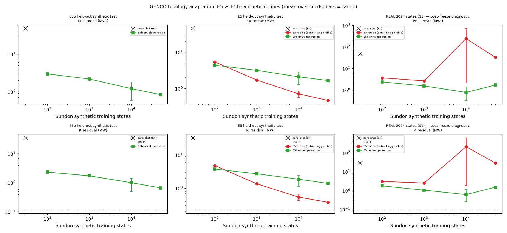

# E5b: real-state transfer test and verdict

_8 October 2026._
- Frozen checkpoint `e5b_ft_n10000_s2` (`e7c4abb`), selected on synthetic validation only.
- Real states were opened only after the freeze.
- Transfer criteria were pre-registered in `14ccda8` ([`configs/experiments/e5b_adaptation.yaml`](../configs/experiments/e5b_adaptation.yaml) `real_transfer`).

To reproduce:

```bash
uv run python scripts/finetune_genco_e5b.py predict --run e5b_ft_n10000_s2 --target S1_WEATHER_ALIGNED
uv run --env-file .env python scripts/evaluate_e5b.py transfer
```

Outputs:
- [`tables/e5b_real_transfer.csv`](tables/e5b_real_transfer.csv)
- [`tables/e5b_import_diagnostic.csv`](tables/e5b_import_diagnostic.csv)
- [`tables/e5b_real_learning_curve.csv`](tables/e5b_real_learning_curve.csv)
- [`experiments/e5b/real_transfer.json`](experiments/e5b/real_transfer.json)

## Answer

- **The broad envelope transfers to the real 2024 states far better than E5. On S1 (2,829 states, identical to E4/E5):**
  - PBE 33.2 → **0.34 MVA**; paired difference against E5 −99.0 % [−99.1 %, −98.9 %];
  - active residual 28.8 → **0.27 MW**, 2.8× DC-PF (E5: 295×);
  - import MAE 71 → 7.3 MW, correlation 0.12 → 0.87;
  - voltage tracking −0.34 → 0.75.

  None of this used any real state, satellite or weather value in training or selection.
- **The pre-registered success criterion is not fully met:**
  - accuracy criteria **R1 and R2 pass**;
  - import tracking **R3** and voltage tracking **R4 fail**;
  - **PARTIAL_TRANSFER** holds.
- **Verdict: E5B-C — partial / inconclusive.** No E5b run passed the synthetic gate (G3), which also maps to C.
- **Coverage hypothesis: INCONCLUSIVE** (pre-registered rule).
  - The evidence points towards coverage mattering a great deal.
  - The decomposition below shows E5's catastrophe was also a checkpoint-specialisation effect, so "primarily coverage" is not established.
- **The model still does not respond to PV.** The slope of predicted import on PV injection is −0.06, against −1.02 in AC. Weather questions therefore remain unresolved, and **S1/S2, ramps and heroes were not rerun**, as pre-registered.

## 1. Same real states, three models

S1 means; percentiles of per-state PBE.

| Metric | Zero-shot (E4) | E5 adapted (`ft_n50000_s0`) | **E5b adapted** (`e5b_ft_n10000_s2`) |
|---|---|---|---|
| PBE mean (MVA) | 48.99 | 33.18 | **0.338** |
| PBE median / p90 / p95 / p99 | 49.2 / 50.3 / 50.7 / 51.4 | 7.1 / 42.0 / 228 / 450 | **0.26 / 0.60 / 0.84 / 1.41** |
| PBE max | 767 | 9,221 | 9.3 |
| Active residual (MW) | 28.90 | 28.85 | **0.271** |
| ×DC-PF (0.098 MW) | 296 | 295 | **2.8** |
| Reactive residual (MVAr) | 34.99 | 12.40 | 0.154 |
| Vm MAE (pu) | 0.0237 | 0.0316 | 0.0144 |
| Va MAE (°) | 2.63 | 2.88 | 0.39 |
| Branch P / Q MAE | 25.0 / 23.0 | 25.7 / 9.1 | **0.85 / 0.32** |
| Voltage tracking (median per-bus r) | 0.40 | −0.34 | 0.75 |

## 2. Pre-registered criteria

| Criterion | Threshold | E5b | Pass |
|---|---|---|---|
| R1 active residual | ≤ 2.885 MW (10 % of E5) | 0.271 | ✓ |
| R2 PBE mean and p95 | ≤ 3.318 and ≤ 10 MVA | 0.338 / 0.844 | ✓ |
| R3 import | sign ≥ 99 %, MAE ≤ 5, r ≥ 0.9, spread 0.75–1.33 | 99.9 %, **7.30**, **0.87**, **0.60** | ✗ |
| R4 voltage | per-bus r ≥ 0.8 and Vm MAE ≤ 0.01 | **0.75** / **0.0144** | ✗ |
| Partial: P1 / P2 / P3 | ≤ 50 % of E5; import r ≥ 0.5 | ✓ / ✓ / ✓ | ✓ |

## 3. REF import diagnostic: does the model follow real operating variation?

| | Sign | MAE (MW) | Bias | r | σ pred / σ AC (MW) | Slope on primary load | on CHAP31 | on PV injection |
|---|---|---|---|---|---|---|---|---|
| AC (truth) | – | – | – | – | 13.9 | **0.93** | **1.00** | **−1.02** |
| Zero-shot | 0.1 % | 260.0 | −260.0 | 0.05 | 3.2 | −0.13 | 0.02 | −0.06 |
| E5 | 99.9 % | 70.7 | +67.8 | 0.12 | 247.0 | −0.24 | 2.43 | −0.66 |
| **E5b** | 99.9 % | **7.3** | **+4.4** | **0.87** | **8.4** | **0.56** | **0.51** | **−0.06** |

- **E5b no longer collapses to the training mean.** E5's import centred near 116 MW against a true 49; E5b's bias is +4.4 MW.
- **It follows load and the battery only about halfway** (slopes 0.56 and 0.51 against 0.93 and 1.00), so its spread is too small (0.60).
- **It does not follow PV** (−0.06 against −1.02). The 0–6 MW of LBUZ PV export barely moves its predicted import. This is the component the weather question depends on.

## 4. Post-freeze diagnostic: every ladder checkpoint on S1

Pre-registered for the combined figure only, never used for selection. Active residual on S1 in MW, with the seed range in brackets.

| Training states | E5 recipe | E5b recipe |
|---|---|---|
| 100 | 3.06 [2.97, 3.15] | **1.77** [1.71, 1.84] |
| 1,000 | 2.50 [2.44, 2.57] | **1.06** [0.97, 1.13] |
| 10,000 | 210 [1.9, 624] | **0.62** [0.27, 1.11] |
| 50,000 | 28.8 | **1.52** |



**Reading:**
- **E5b is better at every size**, and stable across seeds.
- **E5's small checkpoints were not catastrophic on real states**: 100–1k states give 2.5–3.1 MW.
- **E5's failure appears as it trains longer on the narrow regime:** one 10k seed reaches 624 MW, and the selected 50k model 28.8 MW.
- **So E5's real-state collapse combines two things:** support (E5b is about 2× better even at 100–1k) and specialisation to the narrow regime with growing data. Synthetic validation cannot see the latter, and selection then picked the most specialised model.
- **E5b also shows mild degradation from 10k to 50k** (0.62 → 1.52 MW) at a lower level.

## 5. Coverage and the hypothesis

| Pre-registered element | Result |
|---|---|
| Verdict | **E5B-C — PARTIAL / INCONCLUSIVE**: partial transfer, and no run passed the synthetic gate |
| `coverage_achieved` (≥ 95 % of S1 inside E5b on every variable) | **false**: max bus Vm 94.9 %; LBUZ nodes 98.9–99.2 %, failing only through the exact-zero quirk ([`e5b_coverage.md`](e5b_coverage.md)) |
| Coverage hypothesis | **INCONCLUSIVE** |

**What the experiment does support:** broadening the synthetic operating envelope from static metadata alone, without real data, cut real-state error by 99 % against E5's selected model. E5b also beats the E5 recipe at every training size.

**What it does not establish:**
- that coverage was the *primary* cause, since E5's small checkpoints were already moderate on real states;
- that coverage is *sufficient*, since import and voltage tracking fail their criteria and the PV response is missing.

## 6. Weather, ramps, heroes

**Not evaluated**, as pre-registered: REAL_TRANSFER_SUCCESS is false.
- See [`e5b_weather_generalisation.md`](e5b_weather_generalisation.md) and [`e5b_ramp_analysis.md`](e5b_ramp_analysis.md).
- The import diagnostic (PV slope −0.06) already indicates the model cannot yet represent the PV response that ramps and weather depend on.

## Attribution

UK Power Networks data (CC BY 4.0). EUMETSAT LSA SAF MDSSFTD, LSA-207 (CC BY 4.0). GENCO `gridfm/genco-pf-transfer` (Apache-2.0).
