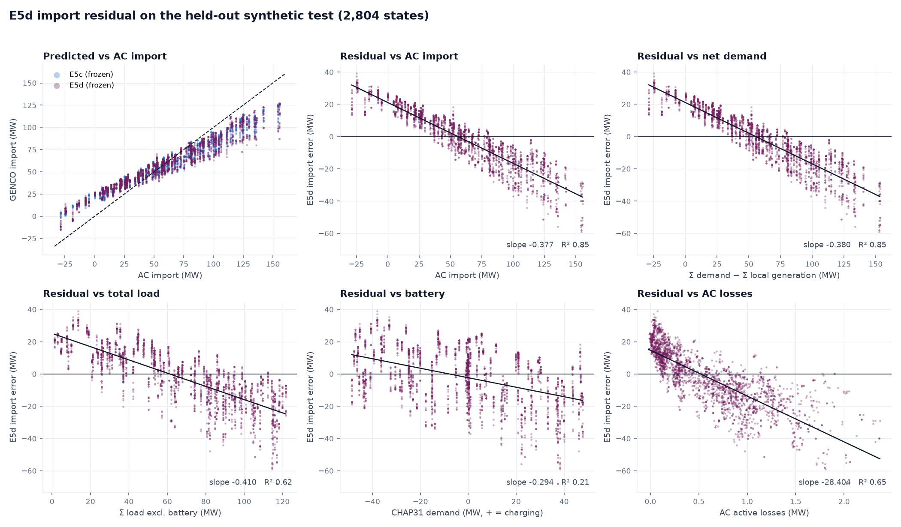
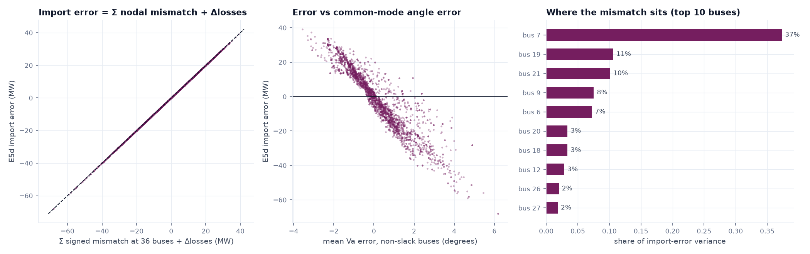
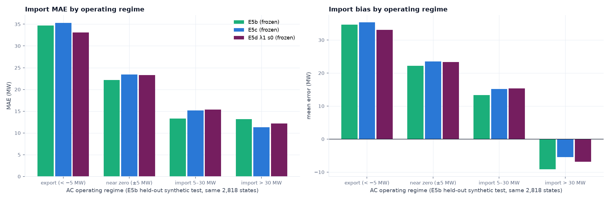
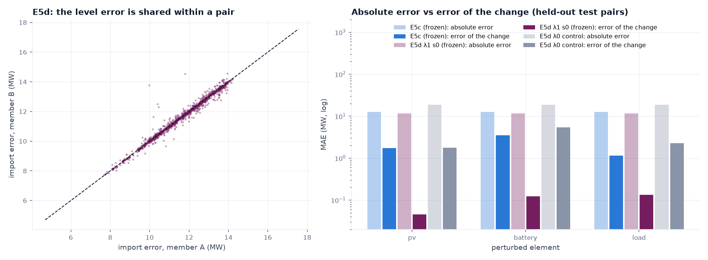

# E6 feasibility diagnostic: why GENCO learns the response but not the absolute import

_13 October 2026._

> **Status: post-hoc diagnostic.**
> - **Not pre-registered**, and **not a trained model**: no E6 checkpoint exists, and no E6 intervention has been validated on any real population.
> - **Nothing frozen changed.** The E4–E5d experiments, data, checkpoints, normalisers, predictions, tables and verdicts are untouched.
> - **Synthetic evidence only.** §§1–11 use the **held-out synthetic** populations and their frozen predictions.
> - **One exploratory section.** §13 re-reads existing frozen 2024 S1 predictions; it is **exploratory** and was not used to design anything proposed here.
> - **The original weather-generalisation question remains unresolved.**

To reproduce:

```bash
PYTHONPATH=src CUDA_VISIBLE_DEVICES= uv run python scripts/diagnose_e6_feasibility.py all
```

- The run is deterministic: all 11 tables reproduce byte-identically, and nothing under `data/` or `metadata/` is written.
- It needs local, non-public frozen artefacts; see §14.
- `PYTHONPATH=src` pins the source tree. The script refuses to run if `cloud2grid` resolves to another checkout.

Outputs:
- **Tables:** [`tables/e6_*.csv`](tables/) (11).
- **Figures:** [`figures/e6_*.png`](figures/) (4).
- **Run record:** [`experiments/e6_feasibility/diagnostic.json`](experiments/e6_feasibility/diagnostic.json), with the sha256 of every prediction file read and the registry hash checks.

## 1. Executive summary

The four kinds of evidence are kept apart: an exact identity, observed correlations, evidence about the training objective, and an open architecture question.

**(i) Demonstrated: a power-balance identity.**
- GENCO does not predict the grid import directly. GraphKit's power-flow decoder computes slack-bus `Pg` from the predicted voltages: it is the sum of the flows on the three branches leaving the slack.
- Every other active injection is a known input.
- Hence, for any predicted state:

  `GENCO import − AC import = (predicted losses − AC losses) + Σ (signed active-power mismatch at the 36 non-slack buses)`

- On the frozen synthetic predictions this holds within **0.06 MW** in every state, for every model.
- The loss difference is small (MAE 0.20 MW). **The import error is essentially the accumulated nodal mismatch of GENCO's predicted voltage state.**

**(ii) Observed on held-out synthetic data (E5d λ = 1 seed 0).**
- **The mismatches are modest per bus but sign-coherent.** They average about 0.7 MW per bus; their signed sum averages 14 MW in absolute value.
- **The import is compressed toward the training mean:**
  - predicted = 21.1 + 0.623 × AC;
  - import MAE 14.21 MW;
  - fixed point 56 MW, against a training mean of 58 MW.
- **Exports are the worst case:** export-state bias is +25.5 MW, and only 22 % of export states are predicted as exports.
- **The level error is shared within response pairs.** On 500 held-out PV pairs:
  - the absolute error of each state is 11.68 MW;
  - the errors of the two states correlate at r = 0.999;
  - the error of the predicted PV-induced change is only 0.046 MW.

  The response loss supervises the change, and the shared level error cancels there.

**(iii) Evidence about the training objective. It is consistent with the observations, but not tested by intervention.**
- **What the ordinary loss contains:**
  - 0.9 × a mean-squared error on Vm and Va;
  - 0.1 × a layer-weighted mean of per-bus power-residual norms;
  - E5d adds λκ × the response loss.
- **The per-bus residual term does penalise every nodal mismatch,** so it bounds the aggregate only loosely (|Σ mismatch| ≤ Σ|mismatch|).
- **No term explicitly prioritises the aggregate signed imbalance** that determines the slack import. The slack residual is zero by construction.
- **The relevant angle errors are numerically tiny.** The slack connects through near-ideal branches (30–39 MW per µrad), so the angle errors that move the import by megawatts (~0.03 µrad per MW) are far below what the Va mean-squared error registers.
- That the objective is *why* the error is coherent is a hypothesis this diagnostic supports but cannot prove. Only an intervention, such as a global-balance term, would test it.

**(iv) Uncertain: architecture.**
- **What argues against a reach problem:**
  - every bus is within reach (graph diameter 8 hops, 12 message-passing layers);
  - GENCO's predicted losses, a global quantity, are accurate.
- **What could point either way:** every model generation compresses the import (slope 0.43–0.75). That is consistent with an objective that never asks for exact global balance, and equally with an architectural difficulty.
- No ablation separates the two.

**What it is not.**
- **No normalisation, sign, decoding or checkpoint defect:**
  - the normaliser is multiplicative and sign-preserving;
  - weights and normaliser match the registries;
  - fed the true AC state, the decoder reproduces AC import within 0.05 MW;
  - the model does output negative imports.
- **Export failure is not sign-specific.** It is the low tail of the same compression: high-import states are biased negative.
- **Response training did not create the import error.** The λ = 0 control is worse (20.9 MW MAE); E5b compresses the same way on the same states (slope 0.60).

**One implementation inconsistency in our E5c encoding (§6, §10), and one upstream question.**
- **The E5c encoding issue:**
  - E5c attached the Leighton Buzzard (LBUZ) generators to PQ buses;
  - GraphKit's internal physics decoder sets `Pg` = 0 at PQ buses, so the physics feedback and physics loss omit that known generation;
  - the evaluation path restores it, so **the frozen metrics remain valid evaluations of the implemented models**;
  - the effect of correcting the encoding has **not** been measured.
- **The upstream question:** GraphKit's power-flow mask treats the slack voltage magnitude as an unknown to predict.

**Accounting baselines are not model improvements.** Summing the known injections gives import MAE 0.58 MW. Adding GENCO's own predicted losses gives 0.20 MW, a *diagnostic accounting reconstruction*. Neither makes GENCO's voltage state any more consistent; both bypass GENCO's import.

**Conclusion.** Accurate electrical states, accurate physical sensitivities and global physical conservation are **distinct model properties**. Good performance on one does not guarantee the others.

**Recommendation: B.** There is strong evidence of a physical-consistency weakness. The E5c encoding issue is reported separately (§15).

## 2. Exact frozen baselines (from frozen reports; not recomputed for any verdict)

| | Value | Source |
|---|---|---|
| E5d λ1 s0 synthetic, E5c held-out test (2,804) | PBE 0.795 MVA; active residual 0.672 MW; import MAE 14.2 MW; sign ≥ 5 MW 95.0 % | `e5d_synthetic_response.md` §3 |
| E5d response, held-out test pairs | ratios pv 0.997, battery 0.998, load 0.962 (E5c: 0.014 / 0.72 / 0.60) | `e5d_synthetic_response.md` §4 |
| E5d real S1 (2,829), for background only | PV slope −1.07 (AC −1.02); load 0.93 (AC 0.93); battery 1.17 (AC 1.00); import r 0.994, MAE 13.16, bias +13.1 MW; Vm MAE 0.0109 pu; verdict E5D-D | `e5d_real_transfer.md` |

**This diagnostic's recomputation matches the frozen values.** On the E5c test:
- E5d import MAE 14.21 MW;
- PBE 0.795 MVA;
- Va MAE 1.146° (frozen 1.15°);
- E5c import MAE 13.61 MW (frozen 13.6).

## 3. Synthetic import residual (E5d λ1 s0, E5c held-out test, 2,804 states)



| Statistic | Value |
|---|---|
| Bias / MAE / RMSE | −1.62 / 14.21 / 17.42 MW |
| Correlation with AC | 0.969 |
| Predicted = a + b × AC | a = 21.1 MW, b = 0.623; spread σ_pred / σ_AC = 0.64 |
| Zero-error fixed point a / (1 − b) | 56 MW (training import: mean 58.0, median 58.0 MW) |
| Sign accuracy, \|AC\| ≥ 5 MW | 95.0 % |

**The synthetic error is not a constant offset.** The bias is near zero, but the error falls linearly with AC import: positive at low import and export, negative at high import. That is regression toward the training mean.

Single-driver fits ([`e6_import_residual_drivers.csv`](tables/e6_import_residual_drivers.csv)):

| Driver of the error | Slope | R² | Reading |
|---|---|---|---|
| AC import | −0.377 | 0.85 | compression toward the mean |
| Net demand (Σ demand − Σ local generation) | −0.380 | 0.85 | identical: import ≈ net demand + losses |
| Total load (excluding battery) | −0.41 | 0.62 | collinear with net demand |
| Local generation (LBUZ) | +0.16 | **0.00** | not a driver at population scale |
| Battery (CHAP31, + = charging) | −0.29 | 0.21 | part of net demand |
| AC losses | −28 MW/MW | 0.65 | collinear with load |
| Slack Vm (masked, §6) | −738 MW/pu | 0.68 | r = 0.986 with load: not separable |
| Common-mode Va error, non-slack buses | −11.7 MW/° | 0.87 | the error is a network-wide angle shift |
| Σ signed nodal mismatch | 1.010 | **1.000** | identity (§5) |
| Load + battery + generation + slack Vm | — | 0.87 | adds almost nothing to AC import alone |

**By regime and generation (E5d)** ([`e6_import_by_stratum.csv`](tables/e6_import_by_stratum.csv)). Percentage error is \|err\| / max(\|AC\|, 5 MW).

| Generation bin | Regime | n | Mean err | MAE | Median % err | Branch P MAE | Vm MAE |
|---|---|---|---|---|---|---|---|
| 0 | export (< −5 MW) | 22 | +27.6 | 27.6 | 358 % | 3.41 | 0.011 |
| 0 | import 5–30 | 44 | +15.9 | 15.9 | 66 % | 2.01 | 0.005 |
| 0 | import > 30 | 217 | −10.4 | 13.6 | 14 % | 1.91 | 0.015 |
| 0–2.5 MW | export | 66 | +27.6 | 27.6 | 121 % | 3.50 | 0.014 |
| 0–2.5 MW | near zero (±5) | 22 | +20.1 | 20.1 | 417 % | 2.42 | 0.013 |
| 0–2.5 MW | import 5–30 | 330 | +15.5 | 15.5 | 84 % | 1.97 | 0.007 |
| 0–2.5 MW | import > 30 | 713 | −10.1 | 13.1 | 13 % | 1.90 | 0.014 |
| 2.5–7.5 MW | export | 88 | +23.4 | 23.4 | 187 % | 3.09 | 0.008 |
| 2.5–7.5 MW | near zero | 44 | +22.7 | 22.7 | 453 % | 3.04 | 0.013 |
| 2.5–7.5 MW | import 5–30 | 198 | +14.4 | 14.4 | 73 % | 1.99 | 0.007 |
| 2.5–7.5 MW | import > 30 | 1,060 | −9.1 | 12.3 | 13 % | 1.83 | 0.015 |

The bias-corrected MAE (diagnostic only) is in the table file.

**Clear-sky / high-PV hypothesis (synthetic).**
- **Not larger at high generation within a regime.** At import > 30 MW the MAE is 13.6 / 13.1 / 12.3 MW from no generation to high generation.
- **Genuinely larger when net import is low or negative** (+15 to +28 MW bias), because of compression.
- **Percentage error explodes near zero** by construction.
- **Branch-flow error is also larger in export states** (3.1–3.5 MW against 1.8–1.9 MW); voltage error is not.

So the synthetic evidence supports a mixture of:
- a level error that becomes more visible as net import falls;
- an additional absolute failure in low-net-demand and export regimes.

Neither is driven by PV as such. Real data: §13, exploratory.

## 4. Import/export failure diagnosis

| Check | Finding | Defect? |
|---|---|---|
| Export states in training | 8.5 % of the 10,000 training states have import < −5 MW (10.3 % negative); test 6.3 %. Import p5 / p50 / p95 = −15 / 58 / 131 MW | coverage thin, not absent |
| Slack labelling | bus 22 is the only `REF` bus; `Pg_target` there equals the AC slack output; the true-state flows reproduce it within 0.06 MW | no |
| Signed preprocessing | powers / baseMVA 36.74, angles deg → rad; no offset, no clipping. Battery `Pd` −35.128 MW → −0.956 → −35.128 MW | no |
| Output transform | slack `Pg` = P_in + Pd − p_shunt, unconstrained (sigmoid bounding is OPF-only). Predictions reach −15 MW | no |
| Loss symmetry | the Vm/Va mean-squared error and the residual-norm term are sign-symmetric | no |
| Error concentration | export MAE 25.5 MW (bias +25.5), near zero +20–23 MW, high import −9 to −10 MW: symmetric compression, largest at the tails | learned failure |
| Export recall (predicted < 0 when AC < −5 MW) | E5c 0 %, E5d λ1 22 %, λ3 48 %, E5b 39 % | learned failure |

**End-to-end trace** ([`e6_trace_examples.csv`](tables/e6_trace_examples.csv)).
- The frozen E5d model was re-run on CPU through GraphKit's own data module. No gradient was computed and nothing was written under `data/`.
- It reproduces the frozen import within 0.23 MW. That small GPU-vs-CPU float32 difference is itself a symptom of the sensitivity in §5.

| Example | AC import | Raw Σ Pd / LBUZ gen / battery (MW) | GENCO import | Decoder on the true state |
|---|---|---|---|---|
| deepest export | −28.80 | −27.43 / 1.42 / −35.13 | −9.26 | −28.81 |
| closest to zero | 0.11 | 6.25 / 6.17 / −12.56 | 25.00 | 0.11 |
| largest import | 155.68 | 154.18 / 0.87 / +37.33 | 126.60 | 155.66 |
| max generation, min net demand | 11.11 | 18.18 / 7.26 / −29.59 | 29.03 | 11.11 |
| median import | 58.28 | 62.45 / 4.44 / −1.08 | 57.68 | 58.26 |

**Inputs, normalisation and decoding are exact.** Fed the true Vm/Va, the decoder returns AC import within 0.05 MW across all 2,804 states.

**The divergence is in the predicted voltage state.** This is a learned-model failure, not an implementation defect in the import path.

## 5. Physical conservation checks

**Identity.** All non-slack injections are inputs, and the decoder defines slack `Pg` from the flows. So:

`GENCO import − AC import = (L_pred − L_AC) + Σ_{i ≠ slack} mismatch_i`

Here mismatch_i = Pg_i − Pd_i − P_in,i(predicted V, θ), with the known generation clamped, as GraphKit's evaluation does.

It holds within 0.06 MW for every model and state ([`e6_model_comparison.csv`](tables/e6_model_comparison.csv), `identity_r2` = 1.000).



| Import estimate (E5c test, E5d model) | Bias | MAE | Max \|err\| | Sign ≥ 5 MW | What it is |
|---|---|---|---|---|---|
| A — AC reference | 0 | 0 | 0 | 100 % | full AC solve (pandapower median 18 ms/state, warm) |
| B — GENCO slack `Pg` (as evaluated) | −1.62 | **14.21** | 68.0 | 95.0 % | GENCO forward pass (5.7 ms/state on CPU, batch 64) |
| C — injections + AC losses | 0.000 | 0.009 | 0.05 | 100 % | accounting check (needs the AC solve) |
| D — injections + GENCO-predicted losses | +0.05 | 0.20 | 1.11 | 100 % | **diagnostic accounting reconstruction**: replaces GENCO's import; GENCO's voltage state is unchanged and still inconsistent |
| E1 — injections, lossless (DC-type balance) | −0.58 | 0.58 | 2.37 | 100 % | a sum of known injections; bypasses GENCO |
| E2 — injections + mean training loss (0.53 MW) | −0.05 | 0.41 | 1.84 | 100 % | a sum; bypasses GENCO |

([`e6_physical_baselines.csv`](tables/e6_physical_baselines.csv))

- **GENCO's predicted losses are accurate** (D). The conservation of its state is not: Σ|mismatch| averages 24.8 MW per state.
- **The 0.098 MW DC-PF figure in earlier reports is a per-bus active residual, not an import error.** A DC-type balance gives 0.58 MW import MAE (E1).

**Where the mismatch sits** ([`e6_residual_by_bus.csv`](tables/e6_residual_by_bus.csv)).
- Mostly at **zero-injection buses**: bus 7 carries 37 % of the error variance, buses 19 and 21 about 10 % each, and bus 6 7 %.
- These are buses where Kirchhoff's current law should hold exactly.
- The error tracks a common-mode angle error over the non-slack buses (r = −0.93).

**Numerical sensitivity** ([`e6_ref_branch_sensitivity.csv`](tables/e6_ref_branch_sensitivity.csv)).
- The slack reaches buses 23–25 through near-ideal branches: |B| = 2.95–3.92 × 10⁵ p.u. on 100 MVA, i.e. **30–39 MW per µrad** of angle difference.
- Each of these flows is wrong by about 4.9 MW (MAE), which corresponds to roughly 0.15 µrad.
- Squared, that is about 10⁻¹⁴ rad²: negligible next to Va errors elsewhere in the network (Va MAE ≈ 0.02 rad, i.e. 1.15°).
- The Va mean-squared error is therefore effectively blind to the angle differences that set the import.
- The per-bus residual term does see MW-scale flow errors, but as a mean of per-bus norms: 36 small residuals of one sign cost about as much as 36 of mixed sign.

## 6. Normalisation and representation audit

| Item | Finding |
|---|---|
| Checkpoint ↔ normaliser | E5d λ1 s0 weights `45ab8252…` and normaliser `9ae23c46…` are in `e5d_checkpoint_registry.yaml`; E5c s2 `31b82424…` / `bb34d0b7…` in the E5c registry. The prediction run records list the same hashes |
| baseMVA | fitted 36.741 MVA (95th percentile of non-zero \|P\|, \|Q\|); `baseMVA_orig` 100. Admittances × 100 / 36.74; powers / 36.74; Va deg → rad; Vm unchanged |
| Signed scaling | multiplicative only |
| Output ordering | bus head → [Vm, Va]; generator head → [Pg]; decoder → [Vm, Va, Pg, Qg] (GraphKit 0.9.0.3 source and trace) |
| Postprocessing | `inverse_output` rescales Pg/Qg; Va stays in radians on export (GraphKit's documented choice); the frozen E5d code converts it correctly |
| **Slack Vm** | **masked by `AddPFHeteroMask`** (`mask_bus[REF, VM_H] = True`): GENCO infers the slack set-point. Predicted sd 0.00006 against true 0.019 p.u.; r = 0.12. Adding it to the error model raises R² only from 0.848 to 0.865, being collinear with load here |
| **LBUZ generators (E5c encoding)** | **the in-model decoder sets `Pg` = 0 at PQ buses** (`PhysicsDecoderPF`). The physics residual feeding the physics MLP and `LayeredWeightedPhysics` therefore omits the known LBUZ generation. Trace: in-model LBUZ residual −0.56 MW against evaluation residual +2.47 MW; the difference equals the generation (max deviation 1 × 10⁻⁶ MW). GraphKit's evaluation clamps the known generation back in |

**LBUZ mismatch against generation** (slope of Σ mismatch at the three LBUZ buses on their generation; 1 = generation entirely unrepresented locally):

| Model (population) | Slope | Mean mismatch |
|---|---|---|
| E5b, negative-load encoding (E5b test) | 0.27 (R² 0.04) | −0.19 MW |
| E5c (E5b test / E5c test) | 1.33 / 0.96 | +3.41 / +1.88 MW |
| E5d λ0 control (E5c test) | 0.98 | +1.74 MW |
| E5d λ1 s0 (E5b test / E5c test) | 0.64 / 0.52 | +3.07 / +2.47 MW |

**Classification: an implementation inconsistency in our E5c encoding**, not a GraphKit bug.
- GraphKit's power-flow decoder assumes non-slack generators sit on PV buses.
- E5c deliberately kept LBUZ as PQ buses (`reports/e5c_design.md`), stating that the "physics [is] identical". That holds for evaluation, not inside the model.

**Minimal fix proposal, not applied.** In a plugin decoder for generator-aware graphs, set `Pg` at non-slack buses to the aggregated known generator output: `where(REF, Pg_ref, agg_bus)`.

**Slack-Vm masking** departs from the textbook power-flow problem, in which the slack voltage is specified. Whether this is intentional in GraphKit is unknown; it is a question for the maintainers.

## 7. E5b / E5c / E5d comparison (same states and preprocessing within each population)



| Population | Model | Import MAE | Bias | Pred-vs-AC slope | r | Sign ≥ 5 | Export recall | PBE | Branch P MAE | Vm MAE | Va MAE (°) | Σ\|mismatch\| |
|---|---|---|---|---|---|---|---|---|---|---|---|---|
| E5b test (2,818) | E5b (frozen) | 14.99 | −0.50 | 0.598 | 0.980 | 95.6 % | 39 % | 0.586 | 2.18 | 0.0114 | 1.13 | 18.5 |
| | E5c (frozen) | 14.16 | +2.52 | 0.628 | 0.984 | 95.2 % | 33 % | 0.614 | 2.34 | 0.0114 | 1.07 | 19.8 |
| | E5d λ1 s0 | 14.65 | +1.38 | 0.619 | 0.974 | 95.5 % | 38 % | 0.758 | 2.02 | 0.0115 | 1.11 | 24.1 |
| E5c test (2,804) | E5c (frozen) | 13.61 | −1.06 | 0.636 | 0.980 | 93.6 % | 0 % | 0.614 | 2.28 | 0.0121 | 1.09 | 19.5 |
| | E5d λ0 control | 20.89 | −1.21 | 0.432 | 0.885 | 93.6 % | 0 % | 0.972 | 2.70 | 0.0108 | 1.50 | 28.6 |
| | E5d λ0.3 | 14.34 | −0.98 | 0.629 | 0.968 | 93.6 % | 0 % | 0.758 | 1.97 | 0.0120 | 1.16 | 23.5 |
| | **E5d λ1 s0** | **14.21** | −1.62 | 0.623 | 0.969 | 95.0 % | 22 % | 0.795 | 2.00 | 0.0125 | 1.15 | 24.8 |
| | E5d λ1 s1 | 37.03 | −13.56 | −0.003 | −0.02 | 93.6 % | 0 % | 2.061 | 4.62 | 0.0162 | 2.38 | 61.4 |
| | E5d λ1 s2 | 31.47 | −7.50 | 0.152 | 0.50 | 93.6 % | 0 % | 1.531 | 3.29 | 0.0110 | 2.06 | 50.1 |
| | E5d λ3 | 12.40 | −1.05 | 0.752 | 0.933 | 96.7 % | 48 % | 1.403 | 1.98 | 0.0159 | 1.23 | 37.5 |

**Comparability.** E5b uses the original encoding, with LBUZ as negative load; E5c and E5d use the generator-aware re-encoding of the *same* states. The AC targets are identical within 1.5 × 10⁻⁵ MW.

Sensitivities (frozen, held-out test pairs, PV / battery / load slope ratio):

| Model | PV | Battery | Load |
|---|---|---|---|
| E5c s2 | 0.014 | 0.72 | 0.60 |
| E5d λ0 | 0.001 | 0.59 | 0.39 |
| E5d λ1 s0 | 0.997 | 0.998 | 0.962 |
| E5d λ3 | 1.003 | 0.978 | 0.766 |

**Reading:**
- **Compression is shared by every generation** (slope 0.60–0.64 for E5b, E5c and E5d λ1).
- **Response training does not degrade the import** (λ0 20.9, λ1 14.2, λ3 12.4 MW).
- **It costs some absolute state accuracy** (PBE 0.61 → 0.80 MVA; Σ|mismatch| 19.5 → 24.8 MW).
- **λ = 1 seeds 1 and 2 collapse**, the seed instability already reported.

## 8. Why the response is right but the level is wrong: direct test on held-out pairs



| Model | Pair type | Level MAE, state A | corr(error A, error B) | MAE of the predicted change | Mean \|ΔAC\| |
|---|---|---|---|---|---|
| E5d λ1 s0 | pv | 11.68 | **0.999** | **0.046** | 1.76 |
| | battery | 11.68 | 0.991 | 0.122 | 12.73 |
| | load | 11.68 | 0.976 | 0.135 | 2.74 |
| E5c s2 | pv | 12.69 | 0.985 | 1.744 | 1.76 |
| | battery | 12.69 | 0.937 | 3.510 | 12.73 |
| | load | 12.69 | 0.990 | 1.137 | 2.74 |
| E5d λ0 | pv | 18.88 | 0.993 | 1.762 | 1.76 |

([`e6_pair_level_cancellation.csv`](tables/e6_pair_level_cancellation.csv); per-pair PV values in [`e6_pv_pairs_e5d.csv`](tables/e6_pv_pairs_e5d.csv); 500 pairs per type)

- **The level error is shared within a pair**, so it cancels in B − A, the quantity the response loss supervises.
- **E5c and the λ = 0 control share the level error just as much.** What they miss is the change itself: their PV change error is about the whole AC change.

## 9. Hypothesis evidence matrix

| Hypothesis | Supporting | Contradicting | Verdict |
|---|---|---|---|
| **A — Representation / normalisation defect** | LBUZ generation dropped inside the model (§6); slack Vm masked | Normaliser multiplicative and sign-preserving; pairing verified; decoder exact on the true state; negative imports produced; E5b, free of the LBUZ issue, compresses equally | **Partially supported.** No normalisation or decoding defect; one encoding inconsistency, secondary in size |
| **B — Missing explicit global-conservation objective** | Identity (§5); mismatches sign-coherent at zero-injection buses; the slack residual is zero by construction; no term targets the aggregate signed imbalance; the import-setting angle differences are ~0.15 µrad | Per-bus residuals *are* penalised (loose bound on the sum); not yet tested by intervention | **Supported** as the best-evidenced explanation; causal test pending |
| **C — Derivative vs absolute trade-off** | PBE and Σ\|mismatch\| rise with response training | Import not worse (λ0 20.9, λ1 14.2, λ3 12.4); the level error is shared within pairs, so the response loss is orthogonal to it | **Contradicted for import; partially supported for PBE** |
| **D — Export distribution / loss imbalance** | Export states 8.5 % of training; export MAE 25–35 MW for every model | Errors symmetric (high import −9 to −10 MW); no sign-asymmetric term; recall improves with λ3 without data change | **Partially supported.** Export failure is the low tail of compression |
| **E — Architecture cannot represent global balance** | Every generation compresses; error is a smooth function of global sums | Reach suffices (8 hops ≤ 12 layers); predicted losses accurate; no ablation | **Inconclusive** |
| **F1 — Ill-conditioned output parameterisation** | 30–39 MW/µrad slack branches; GPU vs CPU float32 differ by 0.23 MW | — | **Supported (mechanism)** |
| **F2 — E5c encoding × GraphKit decoder** | §6; E5b unaffected | Mean 2.5–3.4 MW: too small to explain the 14 MW MAE | **Supported (secondary)** |
| **F3 — Hidden slack voltage set-point** | Masked; predicted as a constant | Not separable from load synthetically (r 0.986) | **Inconclusive** |

## 10. Consequences for the interpretation of the frozen experiments

The frozen verdicts and metrics stand: they are correct evaluations of the models as implemented. Two statements in the narrative should be scoped.

- **E5c (generator-aware).**
  - *Not supported as written:* "Explicit generator representation does not solve PV blindness."
  - *Supported:* **our generator-aware adaptation remained largely insensitive to PV.** This diagnostic later found an internal generator-encoding inconsistency (§6), so the independent effect of a correctly integrated generator representation remains **untested**.
  - The inconsistency may have reinforced E5c's PV blindness. That is not established: E5b, which has no such inconsistency, was also PV-blind on real states (slope −0.06).
- **E5d (response-aware).**
  - **Within the tested implementation**, paired-response supervision made the difference: the λ = 0 control with identical code, data and seed stayed PV-blind (0.001).
  - This does not show that response supervision is universally necessary, or that no other route would teach the sensitivity.
  - E5d's real-state model also carries the LBUZ inconsistency.

## 11. Possible E6 designs

Replacing GENCO's import with the balance identity (E1/E2/D) is useful engineering, not a better foundation model.

| Idea | Addresses | Improves GENCO or replaces it? | Added cost | Baseline doing the same | Should improve | May regress |
|---|---|---|---|---|---|---|
| Analytic import substitution | import level | **replaces** | none | E2 (0.41 MW) | import only | nothing; flows and mismatch unchanged |
| Hard projection layer (distribute Σ mismatch onto the state) | conservation at inference | mostly replaces | small | E2 + least-squares correction | import, slack-branch flows | Vm/Va realism; responses |
| **Global-balance loss**: λ_g · (Σᵢ mismatchᵢ / baseMVA)², i.e. slack `Pg` supervision | the level the objective does not target (§5, §8) | **improves GENCO**: inference unchanged | negligible | none for flows and voltages; E2 for import | import, export recall, slack-branch flows, Σ\|mismatch\| | PBE, seed stability; responses should be unaffected (§8) |
| Fix the LBUZ encoding (§6) | wrong physics signal inside the model | implementation fix | none | — | LBUZ mismatch; possibly PV realism | — |
| Expose the slack Vm set-point | hidden input | task-definition change | none | — | Vm level; possibly import | comparability with the official task |
| Larger response weight | compression | improves | none | — | import slope (λ3: 0.75) | PBE (λ3: 1.40 MVA) |
| Global readout / virtual node | global aggregation | architectural change | small | — | import level | attribution to the official checkpoint |

## 12. Computational feasibility

- **Inference.**
  - GENCO: 5.7 ms per state (CPU, batch 64).
  - AC: 18 ms (pandapower, warm) / 23 ms (PowerModels).
  - Identity baselines: microseconds.
  - On this 37-bus network GENCO is not a CPU speed win, so its value must come from accuracy and transfer.
- **Training.**
  - A global-balance arm costs the same as E5d: about 4.6 h per run with six runs sharing two GPUs.
  - Two arms (encoding fix only; fix + balance term) × three seeds is about 28 GPU-hours.

## 13. Leakage risks, and the exploratory S1 note

**Exploratory only.** This re-reads existing frozen E5d S1 predictions ([`e6_exploratory_real_s1.csv`](tables/e6_exploratory_real_s1.csv)). It was not used to motivate, design or tune anything in §11, which follows from code inspection and synthetic evidence.

- **The same identity holds:** Σ mismatch 12.96 MW + Δloss 0.14 MW = 13.09 MW bias.
- **The error is nearly constant** (sd 2.7 MW).
- **It rises slightly with PV:** 12.4 / 13.2 / 13.7 MW from the low to the high PV tercile. That is consistent with the LBUZ inconsistency, but not confirmed.
- **It rises with import** (+7.4 MW at 5–30 MW; +13.7 MW above 30), unlike the synthetic compression.
- **The real slack Vm is fixed at 1.000 p.u.**, while synthetic states at similar load sit near 1.02. A synthetic-fitted error model accounts for only about 7 of the 13 MW.
- The real offset is the same non-conservation mechanism shifted by a synthetic-to-real difference that cannot be diagnosed further without re-using the real population.

**A credible E6 requires:**
1. **A new pre-registration before any code:**
   - the arms (encoding fix only; fix + global-balance term);
   - λ_g fixed in advance from a synthetic scale inspection;
   - seeds 0–2;
   - the E5d recipe and data unchanged.
2. **Gates:**
   - the unchanged E5d synthetic gates (ST1–5, RS1–5 × 3, RT1–3) and real gates (R1–R7), **not weakened**, evaluated on GENCO's own import;
   - plus pre-declared diagnostics: Σ|mismatch|, slack-branch flow MAE, export recall, pred-vs-AC slope.
3. **Mandatory baselines in every table:** E1/E2, D and "E5d + analytic substitution". E6 counts as a model improvement only where it beats substitution: flows, voltages and mismatch, with the responses retained.
4. **Selection on synthetic data only;** deterministic seeds.
5. **An untouched real population:**
   - another Sundon year (2023 or 2025, if UKPN and LSA SAF data can be assembled) or Canterbury South;
   - S1/S2 2024 may not be used to confirm or tune.
6. **No S1-derived choices.** The slack-Vm observation above must not set any parameter.

**Before 25 October:** no untouched real population exists, and building one takes days. **An E6 run before the deadline could only be exploratory.**

## 14. Reproducibility and artefact availability

| Artefact | Needed for | Public in this repository? |
|---|---|---|
| `scripts/diagnose_e6_feasibility.py` | the diagnostic | yes |
| `reports/tables/e6_*.csv` (11), `reports/figures/e6_*.png` (4), `reports/experiments/e6_feasibility/diagnostic.json` | checking every number and figure | yes |
| Frozen synthetic predictions: `data/interim/e5{b,c,d}/predictions/*` (≈1.6 GB) | re-running the diagnostic | **no** (local research outputs; the input sha256 are in `diagnostic.json`) |
| E5d test pair manifest (`data/interim/e5d/pairs/test/pairs.parquet`) | §8 | **no** (regenerable with `scripts/build_e5d_pairs.py`) |
| E5c synthetic dataset (`data/interim/e5c/synthetic`) and E5d checkpoint + normaliser | trace (§4), training-coverage (§4) | **no** (checkpoints are not redistributed; their sha256 are in the registries) |
| gridfm-graphkit 0.9.0.3, PyTorch (`uv sync --extra genco`) | trace | via the lock file |

**The diagnostic is not independently re-runnable from a clean checkout.** Its inputs are local frozen research outputs. Regenerating them requires the UKPN and LSA SAF data access, the official GENCO checkpoint and the E5–E5d pipelines.

What a clean checkout *can* verify:
- every reported number against the published tables (`tests/satellite/test_e6_diagnostic.py`);
- the submission figure 06, which is built only from the published tables.

## 15. Recommendation: **B — strong evidence for a physical-consistency weakness**

**Why B.**
- **The mechanism is an exact identity, verified end to end:** GENCO's import error is the accumulated non-conservation of its predicted state (§5).
- **The objective does not explicitly target that aggregate,** and response supervision is orthogonal to it (§8).
- **It is common to every model generation** (§7).
- **It is not an import-path, normalisation or sign defect** (§§4, 6).
- **Still to be tested:** that the objective, rather than the architecture, is the cause. That needs the intervention below.

**Reported separately:**
- **A-class implementation issue:** the LBUZ encoding inconsistency (§6). Its minimal fix is one line in a plugin decoder; it is secondary in size and must be assessed as its own arm.
- **Upstream question:** slack-Vm masking.

**For import alone, physics anchoring gives no advantage over the identity baselines (0.41 MW).** An E6 built around import anchoring is not worth running.

### Future work (not started): conservation-supervised GENCO

- **Question:** does adding a global signed power-balance term to the E5d objective make GENCO's own predicted state conservative without losing the learned responses?
- **Arms:** (i) LBUZ encoding fix only; (ii) fix + λ_g · (Σᵢ mismatchᵢ / baseMVA)².
- **Common to both:** E5d λ = 1, seeds 0–2, identical data.
- **Success:** the unchanged E5d gates on GENCO's own import, plus pre-declared gains in Σ|mismatch| and slack-branch flows over arm (i) and E5d, reported against the accounting baselines.
- **Confirmation:** only on an untouched real population.

**For the hackathon: publish the existing result, with this diagnosis as a finding. Do not run E6 before the deadline.**
