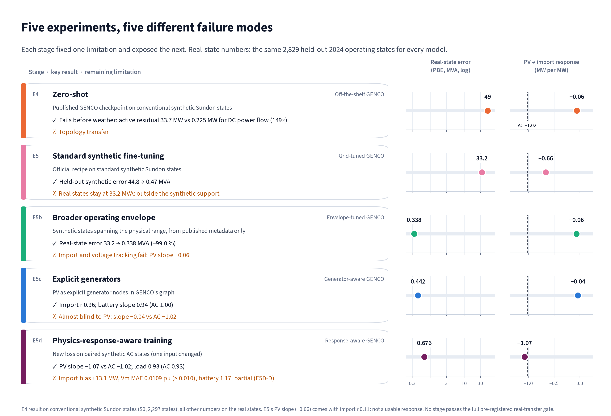

# ☁️⚡ Cloud2Grid: from real clouds to electric grid intelligence

*Can GENCO, a grid foundation model trained on synthetic networks, follow a real UK distribution grid as real clouds pass over it?*

**🖥️ [Interactive Explorer](https://cloud2grid.streamlit.app/) · 💻 [Code](https://github.com/hinox13/grid2cloud) · 📦 [Frozen models + verification data](https://github.com/hinox13/grid2cloud/releases/tag/cloud2grid-models-v1) · 🔁 [Reproduce in one command](https://github.com/hinox13/grid2cloud/blob/cloud2grid-models-v1/reproduce/README.md)**


*Real clouds → solar power → a real power grid → GENCO. Each panel is labelled with its provenance: observed imagery, derived PV, simulated AC power flow, predicted GENCO output.*

### In 30 seconds

- **Out of the box, GENCO cannot read a real grid it has never seen.** On 2,829 real 2024 operating states of the Sundon network (UK Power Networks), it predicts that Sundon exports about 211 MW; the physics says it imports about 49 MW. The direction is wrong in 99.9 % of states.
- **Four synthetic-only fine-tuning steps fix most of it, and our new loss teaches the physics.** Broader synthetic coverage cuts the real-state power-balance error by 99 %. A **physics-response-aware loss**, trained on pairs of synthetic AC states, makes GENCO's grid import respond to solar like the physics: **−1.07 MW per MW of PV, against −1.02 in AC** (−0.04 without it).
- **But accurate sensitivities did not give an accurate state.** The response-aware model's import is still **13.1 MW too high**, so its pre-registered verdict is *partial transfer*. A post-hoc diagnostic shows why: the level error is shared by both states of every training pair, so it cancels in the change the new loss supervises.

| | Original GENCO | Best state accuracy (E5b) | Response-aware (E5d) | AC physics |
|---|---:|---:|---:|---:|
| Real-state power-balance error (MVA) ↓ | 49.0 | **0.338** | 0.676 | 0 |
| Grid-import response to PV (MW per MW) | −0.06 | −0.06 | **−1.07** | −1.02 |
| Grid-import bias (MW) | −260 | +4.4 | +13.1 | 0 |

*Same 2,829 real half-hourly 2024 states for every model. AC values are simulated physical references, not measurements.*

---

## 1. The problem: a foundation model meets a real grid

Grid foundation models such as GENCO are trained and tested on synthetic networks with synthetic operating states. Real distribution grids differ in three ways at once: their topology is idiosyncratic, their states are shaped by real demand and storage, and their renewable output follows the weather. We asked whether GENCO transfers to such a grid, and what it takes when it does not.

## 2. The idea: Earth observation + open grid data + synthetic physics

Cloud2Grid connects three open sources end to end, and keeps every layer's provenance explicit:

| Layer | Source | Class |
|---|---|---|
| Cloud imagery | EUMETSAT Meteosat E-View, every 15 minutes | Observed |
| Solar power | EUMETSAT LSA SAF surface radiation at every registered PV plant, converted with pvlib | Derived |
| Grid states | AC power flow on the network rebuilt from UK Power Networks open data | Simulated |
| GENCO output | the official `gridfm/genco-pf-transfer` checkpoint, then our fine-tuned versions | Predicted |

GENCO is only ever **trained** on synthetic states generated with gridfm-datakit on the rebuilt network. Real 2024 states are used for evaluation only, after each model is frozen.

## 3. A real grid, rebuilt and independently validated

- **Sundon**, a 132/33/11 kV UK Power Networks area in Bedfordshire, rebuilt from published network data: **38 nodes, 44 branches**, every parameter traced to a published UKPN identifier.
- **Two independent AC solvers agree:** pandapower and gridfm-datakit's PowerModels.
- **Validated against metered circuits never used as inputs** (200 timestamps over 18 months): 100 % AC convergence, total grid-import NMAE **0.084**, power-flow direction correct **99–100 %** of the time. Pre-registered verdict: *usable with limitations*.

<details>
<summary><b>Validation details</b></summary>

| Criterion (fixed before the run) | Usable (B) | Strong (A) | Result |
|---|---|---|---|
| Structural checks | all pass | all pass | all pass |
| AC power-flow convergence | ≥ 99 % | 100 % | 100 % (200/200) |
| Core circuits meeting the fit | ≥ 60 % with r ≥ 0.8 | ≥ 80 % with r ≥ 0.9 | 100 % (B); 64 % (A) |
| Direction agreement per core circuit | ≥ 0.90 | ≥ 0.95 | 0.99–1.00 |
| Total import NMAE | ≤ 0.25 | ≤ 0.10 | 0.084 |

The strong level fails on one criterion: four core circuits reach r = 0.86–0.88 against the 0.9 threshold. The report traces the import error mainly to the metered battery-customer circuit. Full report: [`reports/e2_operational_validation.md`](https://github.com/hinox13/grid2cloud/blob/main/reports/e2_operational_validation.md).

</details>

## 4. From satellite to solar power

- **Historical capacity, not today's:** only **8.945 MW** of Sundon's PV was connected in 2024 (against 43.9 MW today), verified from connection dates in the Embedded Capacity Register and published network statements.
- **Every 15 minutes, April–September 2024:** LSA SAF surface radiation is sampled at each plant and converted to output with a fixed, documented pvlib chain (Hay–Davies transposition, Faiman cell temperature, PVWatts). 9,040 slots, of which 8,308 are usable.
- **An estimate, never a measurement.** The PV model was configured before any radiation data were available, and it is never fitted to grid data.

## 5. Zero-shot: GENCO fails before the weather even matters

On conventional synthetic Sundon states, with no weather at all, the official GENCO checkpoint leaves an active-power residual of **33.7 MW, against 0.225 MW for a simple DC power flow (149×)**. Topology transfer fails first. Our environment reproduces the GENCO paper's own IEEE 118 zero-shot result to within 0.03 % on every metric, so this is not a tooling problem.

## 6. Five experiments, five failure modes



Every experiment was pre-registered: gates, selection rules and verdict rules were committed before its data or training existed. Checkpoints were selected on synthetic data only, then frozen and SHA256-hashed before any real state was opened; failed gates are kept, not relaxed. Each experiment fixed one limitation and exposed the next:

1. **Zero-shot (E4):** topology transfer fails (above).
2. **Standard synthetic fine-tuning (E5):** held-out synthetic error falls from 44.8 to 0.47 MVA, but real states stay at 33.2 MVA, because real operation lies outside the synthetic support.
3. **A broader operating envelope (E5b): −99.0 % real-state error.** Synthetic states spanning the physically plausible range, built from published metadata only, bring the real-state error to 0.338 MVA.
4. **Generator-aware adaptation (E5c):** import correlation reaches 0.96 and the battery response 0.94 (AC 1.00), but the import barely responds to PV.
5. **Physics-response-aware training (E5d):** the PV sensitivity is learned and transfers; the absolute level is not calibrated.

| Stage | PBE (MVA) ↓ | Active res. (MW) ↓ | Import MAE (MW) ↓ | Import r ↑ | PV slope (AC −1.02) |
|---|---:|---:|---:|---:|---:|
| E4 Original GENCO | 49.0 | 28.9 | 260 | 0.05 | −0.06 |
| E5 Grid-tuned | 33.2 | 28.8 | 70.7 | 0.11 | −0.66¹ |
| E5b Envelope-tuned | **0.338** | **0.270** | **7.30** | 0.87 | −0.06 |
| E5c Generator-aware | 0.442 | 0.342 | 7.74 | 0.96 | −0.04 |
| E5d Response-aware | 0.676 | 0.567 | 13.2 | **0.994** | **−1.07** |

*Real states, same 2,829 for every model. PBE = mean nodal power-balance error. DC power-flow active residual: 0.098 MW. ¹ E5's slope comes with an import 17.7× too dispersed (r 0.11): not a usable response.*

## 7. The discovery: GENCO was blind to solar, and a response loss fixes it

**Why GENCO ignored PV.** A PV change of a few MW moves the grid import by the same few MW. In GENCO's ordinary loss, that is a tiny fraction of the error in a state importing about 50 MW, so the model can fit absolute states well and still ignore the change. The generator-aware model (E5c) did exactly that: on held-out synthetic pairs its import response was 1.4 % of the true one.

**Our extension: teach the response, not just the state.**
- **Paired synthetic AC states.** Each pair is identical except for one input: the PV output, the battery or one load. Both states are solved with full AC power flow.
- **Supervise the change.** The loss penalises the gap between GENCO's predicted change, ŷ(B) − ŷ(A), and the AC change, for grid import, branch flows, voltage magnitudes and angles. It is normalised per MW of perturbation, so a 0.05 MW PV step counts as much as a 5 MW one.
- **Keep the original objective.** The total loss is L_original + λ·κ·L_response. It runs as a plugin task inside the official gridfm-graphkit fine-tuning loop and adds no parameters.

Only synthetic states and static network metadata were used for training, normalisation and checkpoint selection. No real state, satellite value or real slope was used.


- **Held-out synthetic pairs:** the PV import-response ratio rises from **0.014 (E5c) to ≈ 1.0 (E5d)** (0.997 published; 0.999 in our fresh-clone CPU re-run). Battery, load and the distributed branch-flow and voltage responses are also recovered. An identical run **without** the response loss stays PV-blind (0.001).
- **Real states the model never saw:** the PV-to-import slope moves from −0.04 to **−1.07** (AC −1.02); the PV-attributed import error falls from 2.77 to **0.14 MW**; the load response is **0.93**, matching AC's 0.93.

## 8. Real-world transfer: what improved, and what did not


**Supported by our results:**
- **Response supervision made the difference in our implementation.** It taught GENCO a renewable-generation sensitivity entirely from synthetic AC solutions, and that sensitivity transferred to unseen real operating states. An identical run without it stayed PV-blind.
- **Coverage matters.** Synthetic operating-envelope coverage is decisive for real-state accuracy: −99 % error from E5 to E5b.

**Not supported:**
- **Full transfer.** The response-aware model's import is biased by **+13.1 MW** (MAE 13.2 MW), its voltage error (**0.0109 pu**) misses the 0.010 pu criterion, and its battery response overshoots (**1.17** MW per MW, against 1.00). Its pre-registered verdict is **E5D-D: partial**.
- **Better everything at once.** States and sensitivities did not improve together: E5b has the lowest power-balance error, E5c the best battery response, E5d the only physical PV and load sensitivity.
- **An operational model.** E5d is a research model, not a validated operational one.

## 9. Why the level is still wrong: a post-hoc diagnostic

E5d gets the *change* in grid import right but the *level* wrong. A post-hoc diagnostic (E6) on held-out synthetic states traces why. It is not pre-registered, no model was trained for it, and no real data were used.

- **GENCO's import is the sum of its own small errors.** GENCO does not predict the import directly; it follows from the predicted voltages, as the power flowing out of the substation. So the import error equals the sum of the small power imbalances that the predicted voltages leave at the other 36 buses (within 0.06 MW in every state). These imbalances share a sign and add up: predicted import ≈ 21.1 + 0.62 × true import, a 14.2 MW mean error.
- **Paired training cannot see this error.** The two states of a pair carry almost the same error (r = 0.999 for PV pairs), so it cancels in their difference, which is the only quantity the response loss supervises: 11.7 MW error in each state, 0.05 MW in the PV-induced change.

![Why response supervision is not enough. Panel A: GENCO-predicted against AC grid import for 2,804 held-out synthetic states, with the identity line and a fitted line predicted = 21.1 + 0.623 × AC, showing predictions compressed toward about 56 MW and export states over-predicted. Panel B: for 500 held-out pairs differing only in PV, the import errors of the two states lie on the diagonal (r = 0.999), and a log-scale bar chart compares the 11.68 MW absolute error per state, the 1.76 MW typical PV-induced change and the 0.046 MW error of the predicted change. A bottom strip states the power-balance identity and that accurate states, sensitivities and global conservation are distinct properties.](figures/06_why_response_is_not_enough.png)

**The lesson: accurate electrical states, accurate physical sensitivities and global physical conservation are distinct model properties.** Good performance on one does not guarantee the others. A simple sum of the known injections reproduces the import within 0.6 MW, but that bypasses GENCO rather than improving it.

<details>
<summary><b>Diagnostic details</b></summary>

- **Synthetic evidence** (frozen E5d, 2,804 held-out states; 500 held-out PV pairs): import MAE 14.21 MW; per-bus mismatches of about 0.7 MW are sign-coherent and sum to about 14 MW; paired-error correlation 0.999.
- **Why the existing terms miss it:** the original loss penalises per-bus residuals but not explicitly their signed sum, and the slack branches are near-ideal (30–39 MW per µrad), so the angle errors that set the import are invisible to the angle-error term.
- **Untested:** whether the objective or the architecture is ultimately responsible.

Full analysis: [`reports/e6_feasibility_diagnostic.md`](https://github.com/hinox13/grid2cloud/blob/main/reports/e6_feasibility_diagnostic.md).

</details>

## 10. Explore it yourself

### 👉 [Open the Cloud2Grid Explorer](https://cloud2grid.streamlit.app/)


1. **Overview:** the question, the four fine-tuning steps and the answer, on one page.
2. **Take the guided tour:** six captioned slides over the 15 June 2024 cloud clearing, advanced with **Next**. A real cloud deck clears over Bedfordshire, satellite-derived PV jumps, the AC grid import falls, and each GENCO stage responds, or fails to.
3. **Explore freely:** switch "Grid shown" between the AC reference and each GENCO stage on three real events: a cloud clearing, broken cumulus and a clear-sky control.
4. **Scientific story, PV response, Model evolution:** the full argument and every number behind it.

Imagery and PV are 15-minute; grid states are the frozen half-hourly real states behind every published metric, never interpolated. The app is a lightweight CPU-only replay: no power flow, inference or download runs in it.

## 11. Frozen models and independent verification

The frozen checkpoints and a held-out verification set are published as a GitHub Release, **[`cloud2grid-models-v1`](https://github.com/hinox13/grid2cloud/releases/tag/cloud2grid-models-v1)**. Anyone can re-run the main synthetic finding with real inference:

```bash
git clone https://github.com/hinox13/grid2cloud
cd grid2cloud
uv sync --extra genco
uv run python reproduce/verify_models.py
```

- **Released:** the E5c and E5d checkpoints, each with its own normaliser, a model card and its SHA256; and public held-out synthetic verification data (1,500 AC-solved response pairs and 2,804 held-out states).
- **What the script does:** it runs real GraphKit inference with both checkpoints (no replay of stored predictions), cross-checks the results against the frozen predictions and the published tables, and reports which claims reproduce.
- **Our fresh-clone checks passed on CPU and GPU:** all **five synthetic claims** reproduced (E5c PV blindness; E5d PV recovery; E5d battery and load responses; E5d distributed responses; both models' remaining absolute import error), and **44/44 scored metrics** within the stated tolerances. CPU inference is deterministic; GPU inference varies slightly between runs, and the tolerances account for it.
- **Scope:** this verifies the **synthetic** findings. The real 2024 results above need operating data that are not in the release, so they are documented but cannot yet be independently recomputed.

<details>
<summary><b>Reproducibility and open-science details</b></summary>

- **Official GENCO / OpenGridFM:** `gridfm/genco-pf-transfer`, gridfm-graphkit and gridfm-datakit, unmodified; the response loss is a GraphKit plugin task.
- **Frozen protocols:** checkpoints were selected on synthetic data only, then frozen and SHA256-hashed before any real state was opened. Failed gates are kept, not relaxed.
- **Automated tests:** 220 tests, including leakage and freeze-before-real checks. On a public clone 191 run and pass; 29 need local research data that are not redistributed and are skipped with the missing file named.
- **Platform:** the verification workflow targets Linux x86-64.
- **Snapshot:** the original challenge snapshot is tag `cloud2grid-submission-v1`.

Technical notes: [`docs/TECHNICAL_NOTES.md`](https://github.com/hinox13/grid2cloud/blob/main/docs/TECHNICAL_NOTES.md).

</details>

## 12. Conclusions and future work

> **In our experiments, synthetic-to-real transfer needed more than exposure to the target topology: synthetic data covering realistic operating regimes, and an objective that explicitly teaches physically meaningful sensitivities. Even then, accurate states, accurate sensitivities and global physical conservation proved to be distinct properties.**

**Limitations, stated plainly:**
- **Full transfer is not achieved.** No stage passes the complete pre-registered real-transfer gate. E5d is not a validated operational model.
- **Real results are not independently reproducible yet.** The release reproduces the synthetic findings only.
- **Seed stability.** Response-aware training varied strongly across seeds, and the findings are not consistently reproduced across training seeds. Selection used synthetic criteria only.
- **The weather question is unresolved.** The pre-registered weather test runs only after full transfer succeeds, so we make no claim either way about weather's effect on GENCO.
- **One network, one satellite pixel.** Sundon's 2024 PV of 1 MW and above sits in one satellite pixel, so spatial weather structure could not be tested.
- **Generator encoding.** From E5c on, our encoding drops the Leighton Buzzard generation inside GENCO's physics feedback. It is restored for evaluation, so the reported metrics stand, but the effect of fixing it is untested.

**Next steps:**
- **Conservation-aware training:** E5d's objective plus an explicit global power-balance term, with the generator encoding corrected and assessed separately; confirmation only on an untouched real evaluation period.
- **A second, more solar-rich network** whose plants span several independent satellite pixels, to test whether the findings replicate and whether spatial weather structure matters.

## Team, contact and licences

- 👤 **Team:** Oriol Hinojo
- ✉️ **Contact:** [open an issue](https://github.com/hinox13/grid2cloud/issues)
- 🖥️ [Explorer](https://cloud2grid.streamlit.app/) · 💻 [Code](https://github.com/hinox13/grid2cloud) · 📦 [Models](https://github.com/hinox13/grid2cloud/releases/tag/cloud2grid-models-v1) · 🔁 [Reproduction](https://github.com/hinox13/grid2cloud/blob/cloud2grid-models-v1/reproduce/README.md)

*Contains modified EUMETSAT Meteosat and LSA SAF data (CC BY 4.0) and UK Power Networks data (CC BY 4.0), which include ONS data (OGL v3.0) and OS data © Crown copyright. GENCO / gridfm: Apache-2.0. Cloud2Grid code and released weights © 2026 Oriol Hinojo, Apache-2.0; verification data CC BY 4.0. Third-party data keep their own licences and are not redistributed; per-source attribution: [`docs/DATA_LICENSES.md`](https://github.com/hinox13/grid2cloud/blob/main/docs/DATA_LICENSES.md) and [`NOTICE`](https://github.com/hinox13/grid2cloud/blob/main/NOTICE).*
